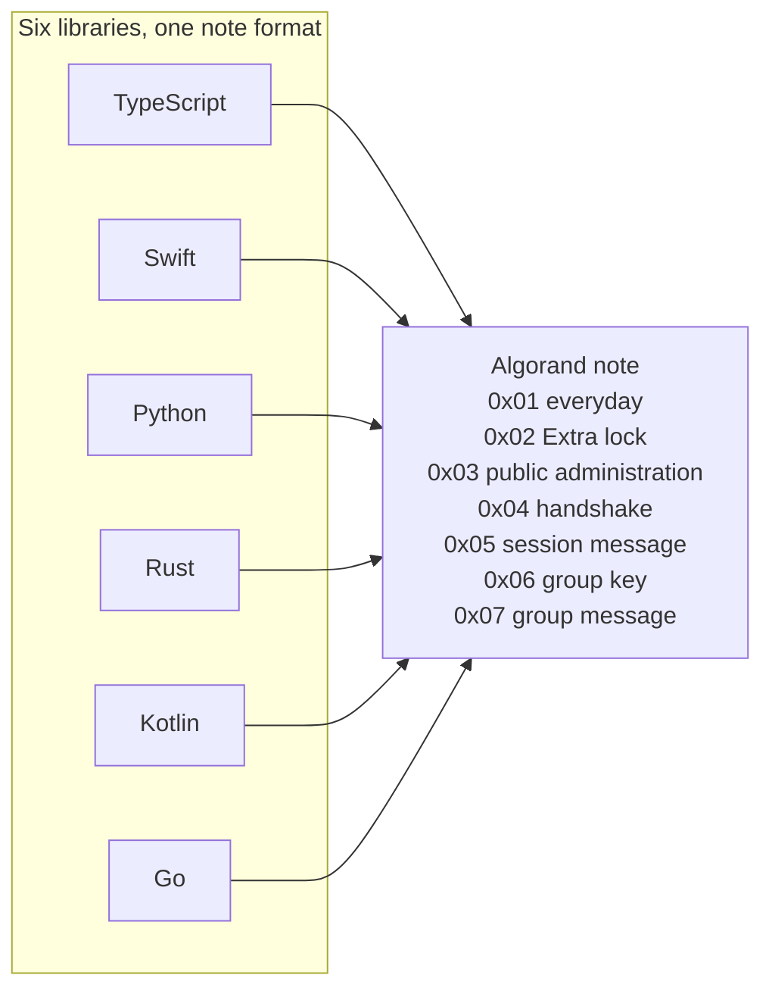
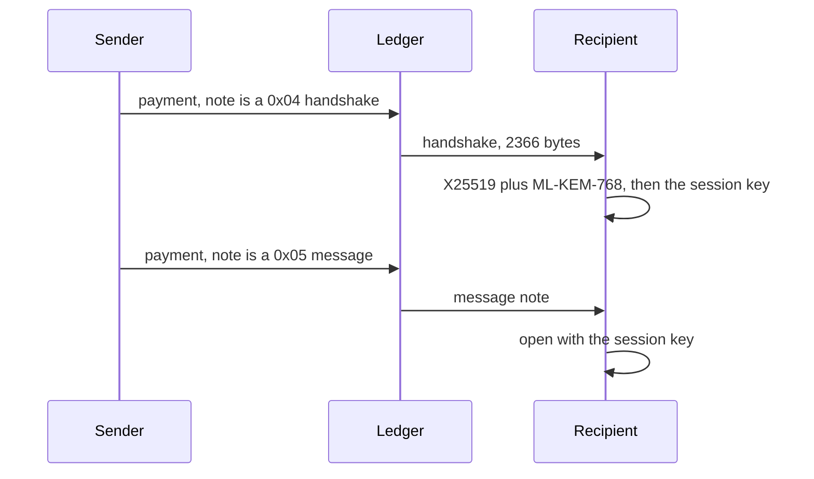

# AlgoChat

[](https://github.com/CorvidLabs/algochat/blob/main/LICENSE)
[](PROTOCOL.md)
[](https://corvidlabs.xyz/algochat/)

End-to-end encrypted messages carried as notes on Algorand payments. One protocol. Six libraries. Your keys stay with you.

This is the public specification and the language implementations. It is not a chat app. [Raven](https://corvidlabs.xyz/raven/) is the CorvidLabs app. Everyday chat still belongs in Signal or Matrix. AlgoChat is the niche where the message is tied to a transaction that anyone can verify and nobody can edit.

**Want a bot in your rooms?** [Run your own bot](py/docs/run-your-own-bot.md) with the Python agent. What is new in 1.6.1 is in [CHANGELOG.md](CHANGELOG.md).

## Libraries

| Path | Language | Protocols | Test |
| --- | --- | --- | --- |
| [`ts/`](ts/) | TypeScript | `0x01`, `0x02`, `0x03`, `0x04`, `0x05`, `0x06`, `0x07` | `bun test` |
| [`swift/`](swift/) | Swift | `0x01`, `0x02`, `0x03`, `0x04`, `0x05`, `0x06`, `0x07` | `swift test` |
| [`py/`](py/) | Python | `0x01`, `0x02`, `0x03`, `0x04`, `0x05`, `0x06`, `0x07` | `pytest` |
| [`rs/`](rs/) | Rust | `0x01`, `0x02`, `0x03`, `0x04`, `0x05`, `0x06`, `0x07` | `cargo test` |
| [`kt/`](kt/) | Kotlin | `0x01`, `0x02`, `0x03`, `0x04`, `0x05`, `0x06`, `0x07` | `./gradlew test` |
| [`go/`](go/) | Go | `0x01`, `0x02`, `0x03`, `0x04`, `0x05`, `0x06`, `0x07` | `go test ./...` |

PQ levels are the integers in [PROTOCOL.md section 5.4.2](PROTOCOL.md#542-pq-levels). Everyday `0x01` is level 0. Extra lock `0x02` is level 1 while the 32-byte pre-shared key stays secret. Hybrid `0x04` and `0x05` are level 3. Group membership `0x06` and group message `0x07` are level 3. Room administration `0x03` is public and has no PQ level. Levels 2, 4, and 5 are not used by a message protocol. A new conversation should start at hybrid `0x04` and `0x05`. That is the base. A room uses that same hybrid session. Everyday and extra lock stay available when the sender chooses them. This version does not stack extra lock on hybrid.

The reported protocol 1.3.0 LocalNet matrix is in [PARITY.md](PARITY.md): six libraries wrote empty, small, large, and maximum notes for `0x01`, `0x02`, and `0x05`, plus one `0x04` handshake each. That historical run reported 540 successful reads. It does not qualify every later commit or every platform; Swift's ML-KEM methods are unavailable on Linux.

Public room administration `0x03` and group mailbox notes `0x06` and `0x07` are in tag v1.4.0. They were not in tag v1.3.0. Version 1.5.0 is the delta room note: the member list is omitted, one room holds 256 people, and a channel is another room the group owner keeps. Version 1.6.0 adds room bots: the owner or an admin adds a bot with a reply mode and a rate limit, and can change them later. [Protocol flows](docs/PROTOCOL-FLOWS.md) explains their integration and known port differences. PROTOCOL.md section 5.8.4 records two LocalNet runs. One creates a group of three, adds a member, removes one, and posts one message. The other puts all six libraries in one group, and each library posts its own line. Those historical reports say every library opened every line; they are not fresh verification of this checkout.





Fenced `mermaid` blocks render on GitHub. The Pages site renders the same fences with Mermaid 11. [_includes/head-custom.html](_includes/head-custom.html) turns a kramdown `language-mermaid` block into a diagram.

## Versions and requirements

This repository is the source for the protocol and all six libraries. Archived language repositories stay archived. Protocol **1.6.0** is the specification version, and **1.6.1** is the current release; each library has its own package version. The table records the versions and requirements declared by this source tree, not registry publication status.

| Library | Package | Package version / tag | Declared language and runtime |
| --- | --- | --- | --- |
| Swift | package `algochat`, product `AlgoChat` | `1.6.1` / `v1.6.1` | [Swift tools 6.0+](Package.swift) |
| TypeScript | `@corvidlabs/ts-algochat` | `0.12.0` | [Node.js 18.0.0+; TypeScript `^5.7.0` for development](ts/package.json) |
| Python | `py-algochat` | `0.6.0` | [Python 3.10+](py/pyproject.toml) |
| Rust | `algochat` | `0.6.0` | [Rust 1.85+; edition 2021](rs/Cargo.toml) |
| Kotlin | `com.corvidlabs:kt-algochat` | `0.5.0` | [Kotlin 2.1.20; JDK 17 toolchain](kt/build.gradle.kts) |
| Go | `github.com/CorvidLabs/algochat/go` | `0.5.0` / `go/v0.5.0` | [Go 1.25.0+](go/go.mod) |

Swift declares iOS 15+, macOS 12+, tvOS 15+, watchOS 8+, and visionOS 1+. Its hybrid ML-KEM methods require Apple OS 26 APIs; release qualification covers macOS 26, and Linux builds without those methods.

Declared requirements and configured CI versions differ. Qualification uses Node.js 22 with Bun 1.3.6, Python 3.12, JDK 17, and Go 1.25; Rust and Swift record the runner's compiler version. The Kotlin wrapper uses Gradle 8.11, while its external consumer uses Gradle 8.14. See [the complete toolchain matrix and unqualified minimum versions](docs/RELEASE.md#language-and-runtime-versions).

The Swift package name is `algochat`. The library product is `AlgoChat`.

```swift
.package(url: "https://github.com/CorvidLabs/algochat.git", from: "1.6.0")
```

```swift
.product(name: "AlgoChat", package: "algochat")
```

Tag `0.4.0` on the archived [swift-algochat](https://github.com/CorvidLabs/swift-algochat) repository belongs to the previous distribution. The monorepo tags `v1.3.0` and `go/v0.2.0` exist on commit `8f4eaff`; their release record and dated registry observations are in [the distribution table](docs/RELEASE.md#package-versions-and-distribution). Source versions do not imply that every registry has published those versions.

## Implementation boundaries and intent

The low-level libraries expose hybrid session APIs; existing high-level clients do not automatically select PQ from a peer's available keys. An application must handle that integration. Standard-mode transaction uniqueness also does not reject an encrypted envelope copied into a different transaction; PSK replay handling requires its state machinery.

[The documentation accuracy and intent report](docs/ACCURACY.md) records checked claims, known implementation gaps, and unverified evidence. The accepted sentences in the root [`hi/`](hi/) remain desired outcomes, with permanent IDs. A structural `hi check` or 100% source/export inventory is not proof that every goal is implemented or independently audited.

## Protocol

Messages are notes on ordinary payments. The sender pays the fee. Standard mode (`0x01`) is X25519 and ChaCha20-Poly1305. Extra lock (`0x02`) mixes in a pre-shared key. A standard note holds up to 3954 bytes of plaintext. An Extra lock note holds 3950. The note itself stops at 4096 bytes.

Falcon-1024 can authorize the payment. It does not encrypt the text. Extra lock resists a break of X25519 only when the two people exchanged that secret off the chain.

The full wire format, fees, and test vectors:

- [PROTOCOL.md](PROTOCOL.md)
- [TEST-VECTORS.md](TEST-VECTORS.md)
- [SECURITY.md](SECURITY.md)
- [Docs on corvidlabs.xyz](https://corvidlabs.xyz/algochat/)

A note of 1024 bytes or fewer pays one minimum fee, 0.001 ALGO for an Ed25519 signature or 0.003 ALGO for Falcon-1024. Bytes past 1024 add a surcharge. A full 4096-byte Ed25519 note is 1,308 microAlgos. The formula is in [PROTOCOL.md](PROTOCOL.md).

## Godot example

[`godot/`](godot/) is a Godot 4 example that calls the Rust library. It is not a seventh protocol implementation. The extension seals and opens everyday notes. A LocalNet bridge can fund an account and post one of those notes. The scene says that addresses, timing, and amounts are public. Extra lock, hybrid sessions, and group mail stay out of this example.

```sh
python3 godot/parity/everyday.py --output /tmp/algochat-godot-parity
```

That command needs a new directory outside this checkout. It seals one version `0x02` everyday note in headless Godot and opens it with TypeScript, Swift, Python, Rust, Kotlin, and Go. Godot then opens one everyday note from each of those six.

## What this does not do

| Limit | What it means |
| --- | --- |
| Metadata is public | Addresses, amounts, and timing are on the chain |
| No deletion | A confirmed note stays |
| No forward secrecy | Account recovery material can expose past messages; PSK mode additionally requires the shared secret |
| Confirmation and indexing | Network confirmation and indexer visibility are separate waits |

## Release qualification

See [the manual release checklist](docs/RELEASE.md) for six-language consumer checks, exact-candidate evidence and unresolved distribution/provenance gates. Qualification does not publish packages.

## Trust

[fledge](https://corvidlabs.xyz/fledge/), [spec-sync](https://corvidlabs.xyz/spec-sync/) 6.1.1, [augur](https://corvidlabs.xyz/augur/), [attest](https://corvidlabs.xyz/attest/), and [hi](https://corvidlabs.xyz/hi/). Human intent is in [`hi/`](hi/).

## License

[MIT](LICENSE).
