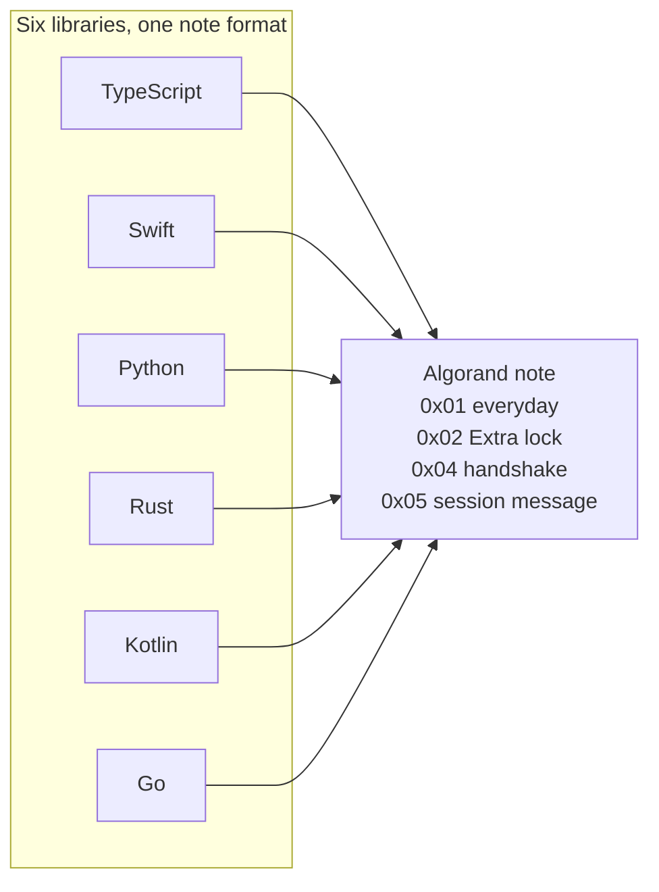

# AlgoChat

[](https://github.com/CorvidLabs/algochat/blob/main/LICENSE)
[](PROTOCOL.md)
[](https://corvidlabs.xyz/algochat/)

End-to-end encrypted messages carried as notes on Algorand payments. One protocol. Six libraries. Your keys stay with you.

This is the public specification and the language implementations. It is not a chat app. [Raven](https://corvidlabs.xyz/raven/) is the CorvidLabs app. Everyday chat still belongs in Signal or Matrix. AlgoChat is the niche where the message is tied to a transaction that anyone can verify and nobody can edit.

## Libraries

| Path | Language | Protocols | Test |
| --- | --- | --- | --- |
| [`ts/`](ts/) | TypeScript | `0x01`, `0x02`, `0x04`, `0x05` | `bun test` |
| [`swift/`](swift/) | Swift | `0x01`, `0x02`, `0x04`, `0x05` | `swift test` |
| [`py/`](py/) | Python | `0x01`, `0x02`, `0x04`, `0x05` | `pytest` |
| [`rs/`](rs/) | Rust | `0x01`, `0x02`, `0x04`, `0x05` | `cargo test` |
| [`kt/`](kt/) | Kotlin | `0x01`, `0x02`, `0x04`, `0x05` | `./gradlew test` |
| [`go/`](go/) | Go | `0x01`, `0x02`, `0x04`, `0x05` | `go test ./...` |

Parity for protocol 1.3.0 is [PARITY.md](PARITY.md). On LocalNet, each library writes empty, small, large, and maximum notes for `0x01`, `0x02`, and `0x05`, and one `0x04` handshake. Every library opens every confirmed note.




Fenced `mermaid` blocks render on GitHub. The Pages site renders the same fences with Mermaid 11. [_includes/head-custom.html](_includes/head-custom.html) turns a kramdown `language-mermaid` block into a diagram.

Published package names stay on the existing repositories for now. This tree is where a wire-format change lands once, with the same test vectors for every library.

Add the Swift library from this repository:

```swift
.package(url: "https://github.com/CorvidLabs/algochat.git", branch: "main")
```

```swift
.product(name: "AlgoChat", package: "algochat")
```

The product is `AlgoChat`. Sources stay in [`swift/`](swift/). Tag `0.4.0` on the archived [swift-algochat](https://github.com/CorvidLabs/swift-algochat) repository still resolves for apps that have not switched the URL.

## Protocol

Messages are notes on ordinary payments. The sender pays the fee. Standard mode (`0x01`) is X25519 and ChaCha20-Poly1305. Extra lock (`0x02`) mixes in a pre-shared key. A standard note holds up to 3954 bytes of plaintext. An Extra lock note holds 3950. The note itself stops at 4096 bytes.

Falcon-1024 can authorize the payment. It does not encrypt the text. Extra lock resists a break of X25519 only when the two people exchanged that secret off the chain.

The full wire format, fees, and test vectors:

- [PROTOCOL.md](PROTOCOL.md)
- [TEST-VECTORS.md](TEST-VECTORS.md)
- [SECURITY.md](SECURITY.md)
- [Docs on corvidlabs.xyz](https://corvidlabs.xyz/algochat/)

A note of 1024 bytes or fewer pays one minimum fee, 0.001 ALGO for an Ed25519 signature or 0.003 ALGO for Falcon-1024. Bytes past 1024 add a surcharge. A full 4096-byte Ed25519 note is 1,308 microAlgos. The formula is in [PROTOCOL.md](PROTOCOL.md).

## What this does not do

| Limit | What it means |
| --- | --- |
| Metadata is public | Addresses, amounts, and timing are on the chain |
| No deletion | A confirmed note stays |
| No forward secrecy | The 25 words open that account's past messages |
| About 4.5 seconds | Algorand finality |

## Trust

[fledge](https://corvidlabs.xyz/fledge/), [spec-sync](https://corvidlabs.xyz/spec-sync/) 6.1.1, [augur](https://corvidlabs.xyz/augur/), [attest](https://corvidlabs.xyz/attest/), and [hi](https://corvidlabs.xyz/hi/). Human intent is in [`hi/`](hi/).

## License

[MIT](LICENSE).
