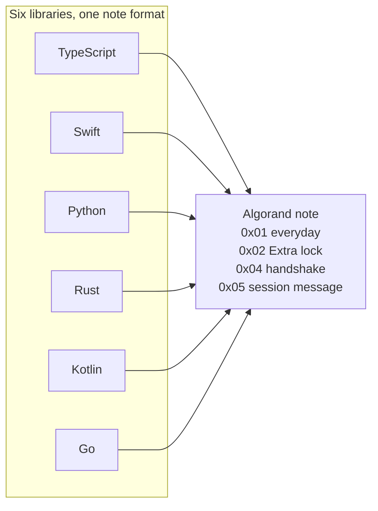
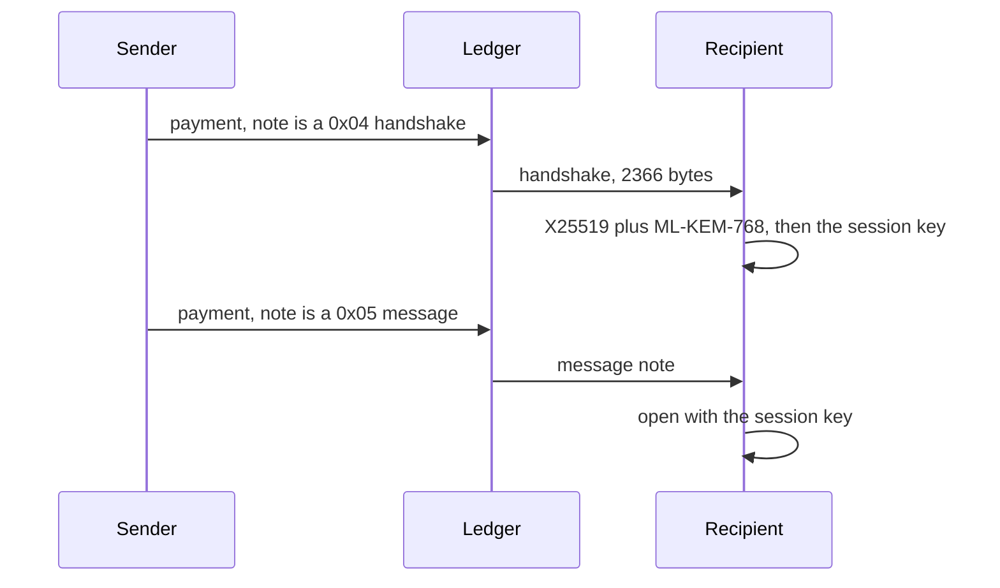

# AlgoChat

[](https://github.com/CorvidLabs/algochat/blob/main/LICENSE)
[](PROTOCOL.md)
[](https://corvidlabs.xyz/algochat/)

End-to-end encrypted messages carried as notes on Algorand payments. One protocol. Six libraries. Your keys stay with you.

This is the public specification and the language implementations. It is not a chat app. [Raven](https://corvidlabs.xyz/raven/) is the CorvidLabs app. Everyday chat still belongs in Signal or Matrix. AlgoChat is the niche where the message is tied to a transaction that anyone can verify and nobody can edit.

## Libraries

| Path | Language | Protocols | Test |
| --- | --- | --- | --- |
| [`ts/`](ts/) | TypeScript | `0x01`, `0x02`, `0x04`, `0x05` | `bun test` |
| [`swift/`](swift/) | Swift | `0x01`, `0x02`, `0x04`, `0x05` | `swift test` |
| [`py/`](py/) | Python | `0x01`, `0x02`, `0x04`, `0x05` | `pytest` |
| [`rs/`](rs/) | Rust | `0x01`, `0x02`, `0x04`, `0x05` | `cargo test` |
| [`kt/`](kt/) | Kotlin | `0x01`, `0x02`, `0x04`, `0x05` | `./gradlew test` |
| [`go/`](go/) | Go | `0x01`, `0x02`, `0x04`, `0x05` | `go test ./...` |

Parity for protocol 1.3.0 is [PARITY.md](PARITY.md). On LocalNet, each library writes empty, small, large, and maximum notes for `0x01`, `0x02`, and `0x05`, and one `0x04` handshake. Every library opens every confirmed note.





Fenced `mermaid` blocks render on GitHub. The Pages site renders the same fences with Mermaid 11. [_includes/head-custom.html](_includes/head-custom.html) turns a kramdown `language-mermaid` block into a diagram.

## Versions and requirements

This repository is the source for the protocol and all six libraries. Archived language repositories stay archived. Protocol **1.3.0** is the specification version; each library has its own package version. The table records the versions and requirements declared by this source tree, not registry publication status.

| Library | Package | Package version / tag | Declared language and runtime |
| --- | --- | --- | --- |
| Swift | package `algochat`, product `AlgoChat` | `1.3.0` / `v1.3.0` | [Swift tools 6.0+](Package.swift) |
| TypeScript | `@corvidlabs/ts-algochat` | `0.9.0` | [Node.js 18.0.0+; TypeScript `^5.7.0` for development](ts/package.json) |
| Python | `py-algochat` | `0.2.0` | [Python 3.10+](py/pyproject.toml) |
| Rust | `algochat` | `0.3.0` | [Rust 1.85+; edition 2021](rs/Cargo.toml) |
| Kotlin | `com.corvidlabs:kt-algochat` | `0.2.0` | [Kotlin 2.1.20; JDK 17 toolchain](kt/build.gradle.kts) |
| Go | `github.com/CorvidLabs/algochat/go` | `0.2.0` / `go/v0.2.0` | [Go 1.25.0+](go/go.mod) |

Swift declares iOS 15+, macOS 12+, tvOS 15+, watchOS 8+, and visionOS 1+. Its hybrid ML-KEM methods require Apple OS 26 APIs; release qualification covers macOS 26, and Linux builds without those methods.

Declared requirements and configured CI versions differ. Qualification uses Node.js 22 with Bun 1.3.6, Python 3.12, JDK 17, and Go 1.25; Rust and Swift record the runner's compiler version. The Kotlin wrapper uses Gradle 8.11, while its external consumer uses Gradle 8.14. See [the complete toolchain matrix and unqualified minimum versions](docs/RELEASE.md#language-and-runtime-versions).

The Swift package name is `algochat`. The library product is `AlgoChat`.

```swift
.package(url: "https://github.com/CorvidLabs/algochat.git", from: "1.3.0")
```

```swift
.product(name: "AlgoChat", package: "algochat")
```

Tag `0.4.0` on the archived [swift-algochat](https://github.com/CorvidLabs/swift-algochat) repository still resolves for apps that have not switched the URL. Those tags are not created by this document.

## Protocol

Messages are notes on ordinary payments. The sender pays the fee. Standard mode (`0x01`) is X25519 and ChaCha20-Poly1305. Extra lock (`0x02`) mixes in a pre-shared key. A standard note holds up to 3954 bytes of plaintext. An Extra lock note holds 3950. The note itself stops at 4096 bytes.

Falcon-1024 can authorize the payment. It does not encrypt the text. Extra lock resists a break of X25519 only when the two people exchanged that secret off the chain.

The full wire format, fees, and test vectors:

- [PROTOCOL.md](PROTOCOL.md)
- [TEST-VECTORS.md](TEST-VECTORS.md)
- [SECURITY.md](SECURITY.md)
- [Docs on corvidlabs.xyz](https://corvidlabs.xyz/algochat/)

A note of 1024 bytes or fewer pays one minimum fee, 0.001 ALGO for an Ed25519 signature or 0.003 ALGO for Falcon-1024. Bytes past 1024 add a surcharge. A full 4096-byte Ed25519 note is 1,308 microAlgos. The formula is in [PROTOCOL.md](PROTOCOL.md).

## What this does not do

| Limit | What it means |
| --- | --- |
| Metadata is public | Addresses, amounts, and timing are on the chain |
| No deletion | A confirmed note stays |
| No forward secrecy | The 25 words open that account's past messages |
| About 4.5 seconds | Algorand finality |

## Release qualification

See [the manual release checklist](docs/RELEASE.md) for six-language consumer checks, exact-candidate evidence and unresolved distribution/provenance gates. Qualification does not publish packages.

## Trust

[fledge](https://corvidlabs.xyz/fledge/), [spec-sync](https://corvidlabs.xyz/spec-sync/) 6.1.1, [augur](https://corvidlabs.xyz/augur/), [attest](https://corvidlabs.xyz/attest/), and [hi](https://corvidlabs.xyz/hi/). Human intent is in [`hi/`](hi/).

## License

[MIT](LICENSE).
