# AlgoChat Protocol: High-Level Design

This document explains how AlgoChat works end to end: the keys, the envelope on the wire, how a message is encrypted and read, how peers find each other's keys, and how the envelope rides on an Algorand payment. It also covers the machinery in this repository (validation, the status dashboard, the trust gate, GitHub Pages).

For current main, [Hybrid sessions and administered rooms](PROTOCOL-FLOWS.md) adds complete discovery, sender/recipient recovery, public `0x03` administration, `0x06` delivery and `0x07` acceptance diagrams, plus source-linked port limitations. The classical send/receive/PSK diagrams below retain their stated scope; they are not automatic routing for every protocol. The group ids are in tag v1.4.0. They were not in tag v1.3.0.

This narrative covers protocol 1.3.0: standard (`0x01`), Extra lock (`0x02`), and the separate optional hybrid session (`0x04`/`0x05`). All six libraries contain low-level helpers for these modes. Their normal high-level conversation send paths do not automatically negotiate hybrid sessions; applications must integrate key discovery, mode selection, handshake transport, and session recovery explicitly. The reported LocalNet matrix from 2026-10-17 is historical interoperability evidence in [PARITY.md](../PARITY.md), which distinguishes the current 2366-byte handshake from the withdrawn 1278-byte layout. Current implementation and qualification gaps are tracked in [ACCURACY.md](ACCURACY.md). The normative text is PROTOCOL.md. If this document and PROTOCOL.md ever disagree, PROTOCOL.md wins. Pseudocode lives in [IMPLEMENTATION.md](../IMPLEMENTATION.md), byte-exact examples in [TEST-VECTORS.md](../TEST-VECTORS.md), and the threat model in [SECURITY.md](../SECURITY.md).

Notation: `‖` means byte concatenation (PROTOCOL.md writes it `||`). `HKDF(ikm, salt, info)` is HKDF-SHA256 with a 32-byte output. `seal` and `open` are ChaCha20-Poly1305 encrypt and decrypt.

**Contents**

1. [Purpose](#1-purpose)
2. [Context](#2-context)
3. [Components](#3-components)
4. [Key flows](#4-key-flows)
5. [Data](#5-data)
6. [Runtime and deployment](#6-runtime-and-deployment)
7. [Security and trust boundaries](#7-security-and-trust-boundaries)
8. [Failure modes and limits](#8-failure-modes-and-limits)
9. [Decisions](#9-decisions)
10. [Open questions found while writing this](#10-open-questions-found-while-writing-this)
11. [Glossary](#11-glossary)

## 1. Purpose

AlgoChat lets two people attach an end-to-end encrypted note to an ordinary Algorand payment, so that only the sender and the recipient can read it, with no mailbox contract, relay server or router app in between ([INTENT.md](../INTENT.md), [hi/send.md](../hi/send.md) `SEND-1`). This monorepo holds the protocol specification, implementation guide, test vectors, threat model, six language libraries, and a registry of six libraries. It does not itself provide a standalone messaging app. Its readers are the people who build AlgoChat libraries (Swift, TypeScript, Python, Rust, Kotlin, Go) and the clients built on them. The protocol is honest about its limits: addresses, timing and message size stay public on-chain, and it does not provide forward secrecy ([hi/honest.md](../hi/honest.md) `HONEST-1`, `HONEST-2`).

## 2. Context

### 2.1 The protocol at run time

Two clients talk only through the public Algorand chain. A sender builds an envelope, puts it in the `note` of a payment, and submits it to an algod node. Readers find AlgoChat payments through an indexer by note prefix. The optional pre-shared key (PSK) for mode `0x02` is exchanged outside the chain. Public encryption keys can also be exchanged out of band; X25519 and ML-KEM announcements are separate formats.

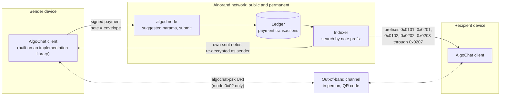

These prefixes describe application dispatch; the classical high-level indexers do not automatically query or integrate every mode. The room reducer and authorization checks are separate from opening an encrypted note.

Sources: [PROTOCOL.md §10](../PROTOCOL.md#10-transport-layer), [§8.6](../PROTOCOL.md#86-psk-exchange), [IMPLEMENTATION.md](../IMPLEMENTATION.md) (Transaction Creation, Key Discovery).

### 2.2 This repository in the ecosystem

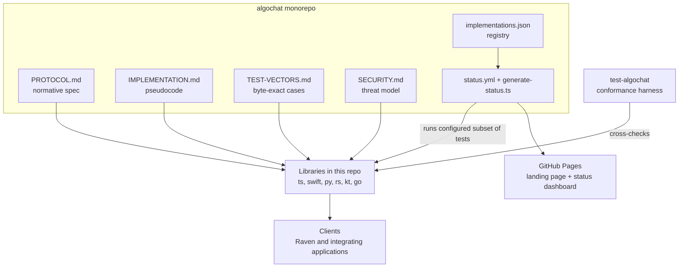

The [README](../README.md) links the app separately; [implementations.json](../implementations.json) lists the six monorepo libraries, including Go, for the status renderer. The archived web client is historical; the current status workflow tests the six monorepo libraries.

## 3. Components

### 3.1 Protocol layers

The protocol has four layers. Protocol 1.2 added Falcon-1024 at the account layer without changing envelope bytes. Protocol 1.2.1 raises the note ceiling to 4096 bytes; 1.3 adds optional hybrid session envelopes ([PROTOCOL.md §14](../PROTOCOL.md#14-version-history)).

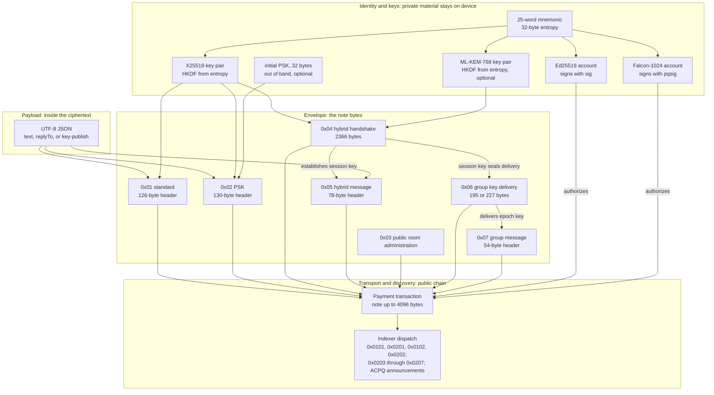

| Layer | What it owns | Spec |
| --- | --- | --- |
| Identity and keys | Mnemonic entropy, the long-term X25519 key pair, the Algorand account (Ed25519 or Falcon-1024), the optional PSK and its counter state, optional ML-KEM keys and hybrid session keys | [§4](../PROTOCOL.md#4-key-derivation), [§8.6](../PROTOCOL.md#86-psk-exchange) |
| Payload | JSON message shapes: text, reply, key-publish; legacy raw UTF-8 text | [§9](../PROTOCOL.md#9-message-payload) |
| Envelope | Byte layout, version AAD rules, protocol id, ephemeral handshake/message key material, sender wrap, session reference, ciphertext | [§5](../PROTOCOL.md#5-envelope-format) to [§8](../PROTOCOL.md#8-psk-ratcheting-mode-protocol-0x02) |
| Transport and discovery | Payment fields, fees, note-prefix filtering, finding a peer's X25519 key | [§10](../PROTOCOL.md#10-transport-layer) |

### 3.2 Key derivation

One mnemonic feeds everything. The AlgoChat X25519 key comes from the 32-byte mnemonic entropy, so it is the same whether the account signs with Ed25519 or Falcon-1024. The same words give **different addresses** under the two schemes, but the **same** AlgoChat encryption keys ([PROTOCOL.md §4.1](../PROTOCOL.md#41-encryption-key-pair), [§4.3](../PROTOCOL.md#43-algorand-account-identity)).

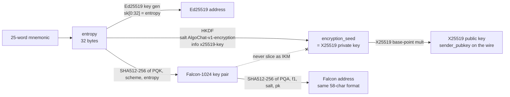

Rules that matter (all from [PROTOCOL.md §4](../PROTOCOL.md#4-key-derivation)):

- For an Ed25519 account the entropy equals `sk[0:32]`. For a Falcon-1024 account it is still the mnemonic entropy. Implementations **MUST NOT** take the first 32 bytes of a Falcon secret key as the IKM; that would silently fork every encryption key.
- Importing 25 words without naming a scheme **MUST** recover the Ed25519 address, so existing wallets do not silently move ([hi/account.md](../hi/account.md) `ACCOUNT-1.a`). Falcon on import must be explicit.
- An Ed25519 account MAY rekey its auth address to a Falcon address. The address stays the same; later payments must carry `pqsig` and pay the Falcon fee.
- The test vectors in [TEST-VECTORS.md §1](../TEST-VECTORS.md#1-key-derivation) feed 32-byte seeds; those seeds are mnemonic entropy.

### 3.3 Repository components

| Path | Owns |
| --- | --- |
| [PROTOCOL.md](../PROTOCOL.md) | The normative protocol, version 1.6.0 |
| [IMPLEMENTATION.md](../IMPLEMENTATION.md) | Language-neutral pseudocode, data structures, error names, PSK UX guidance |
| [TEST-VECTORS.md](../TEST-VECTORS.md) | Byte-exact vectors for key derivation, envelopes, round trips, PSK schedule, size limits |
| [SECURITY.md](../SECURITY.md) | Threat model, PSK threat matrix, key handling guidance, vulnerability reporting |
| [README.md](../README.md) | Overview, limits, economics, implementation list |
| [INTENT.md](../INTENT.md), [hi/](https://github.com/CorvidLabs/algochat/tree/main/hi) | Human intent: what the protocol should be, with permanent criterion ids |
| [implementations.json](../implementations.json) | Six-library registry consumed by the status renderer; the legacy workflow tests a subset and omits Go |
| [scripts/validate.ts](https://github.com/CorvidLabs/algochat/blob/main/scripts/validate.ts) | The `validate` task: the five protocol documents exist and are non-empty, registry ids are present and unique |
| [scripts/generate-status.ts](https://github.com/CorvidLabs/algochat/blob/main/scripts/generate-status.ts) | Builds `status.html` and `badges/*.svg` from per-implementation test results |
| [index.html](../index.html), [status.html](../status.html), [_config.yml](https://github.com/CorvidLabs/algochat/blob/main/_config.yml), [_includes/head-custom.html](https://github.com/CorvidLabs/algochat/blob/main/_includes/head-custom.html) | The GitHub Pages site: hand-written landing page, generated dashboard, Jekyll config, Mermaid rendering |
| [.github/workflows/status.yml](https://github.com/CorvidLabs/algochat/blob/main/.github/workflows/status.yml) | Daily implementation tests, dashboard generation, Pages deploy |
| [.github/workflows/trust.yml](https://github.com/CorvidLabs/algochat/blob/main/.github/workflows/trust.yml) | The CorvidLabs trust gate on pull requests and pushes to `main` matching its path filters |
| [fledge.toml](../fledge.toml), [.trust.toml](https://github.com/CorvidLabs/algochat/blob/main/.trust.toml), [.augur.toml](https://github.com/CorvidLabs/algochat/blob/main/.augur.toml), [.attest.json](https://github.com/CorvidLabs/algochat/blob/main/.attest.json), [.specsync/](https://github.com/CorvidLabs/algochat/tree/main/.specsync) | Task, lane and trust-gate configuration, and SpecSync change records |

## 4. Key flows

### 4.1 Find a peer's encryption key

To write to someone you need their X25519 public key. Standard/PSK, hybrid and group-delivery headers carry a sender X25519 key in clear. Public room administration and group-message notes do not: do not extract a sender encryption key from `0x03` or `0x07`. The pseudocode in [IMPLEMENTATION.md](../IMPLEMENTATION.md) (Key Discovery) scans both accepted envelope versions of standard and PSK notes. The current TypeScript discovery also searches self-payment key announcements with pagination and prefers verified signed announcements. Hybrid ML-KEM announcements require separate parsing and application integration.

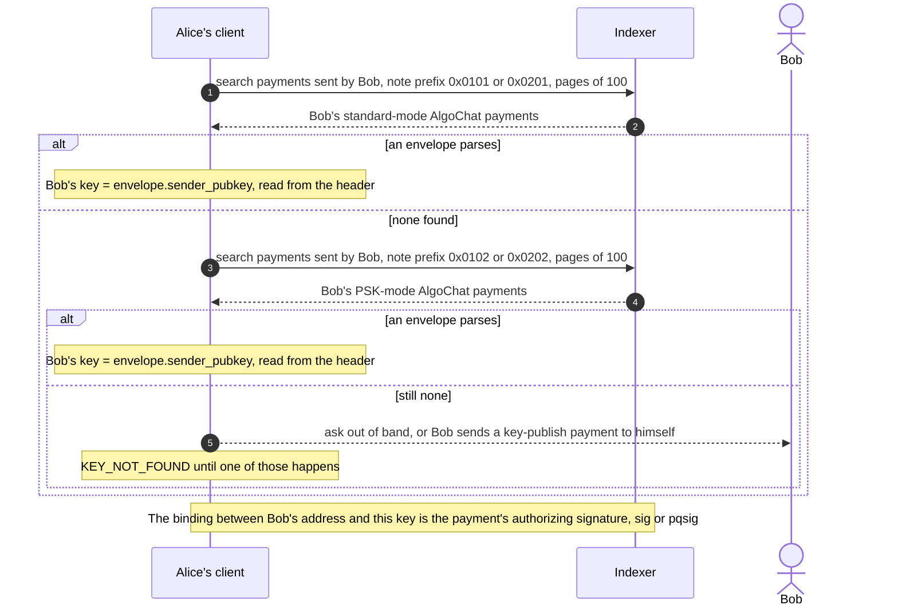

Three discovery methods are defined ([PROTOCOL.md §10.2](../PROTOCOL.md#102-key-discovery)): scan the recipient's sent transactions, look for a key-publish message the recipient sent to themselves, or exchange keys out of band. Only someone who can spend from an address can publish a payment from it, and that is what ties the X25519 key to the address. An extra Ed25519 signature over the X25519 key (the v1.1 announce format) is optional, only defined for Ed25519 addresses, and **MUST NOT** be required from Falcon-1024 senders.

### 4.2 Send a standard message (`0x01`)

Every standard message gets a fresh ephemeral X25519 key pair. The message key comes from ephemeral-to-recipient ECDH. The same message key is then wrapped for the sender under a second key from ephemeral-to-sender ECDH, which is what lets the sender re-read their own history from the chain on any device, without keeping plaintext ([PROTOCOL.md §2](../PROTOCOL.md#2-design-goals) goal 3, [§6](../PROTOCOL.md#6-encryption)).

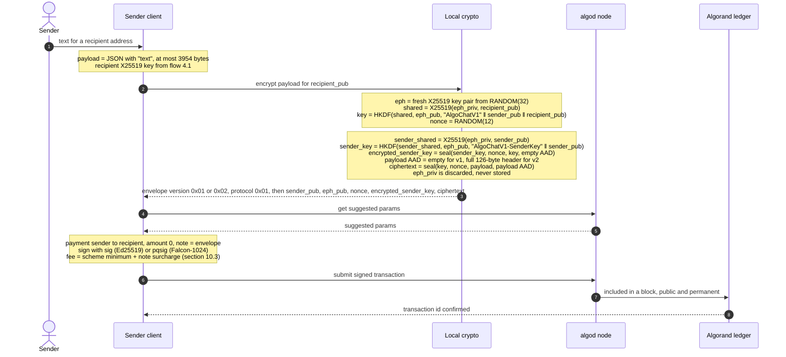

Points that trip implementers:

- One nonce is used twice, under two different keys: once for the message and once for the sender key wrap. That is how the spec defines it ([§6.2](../PROTOCOL.md#62-sender-key-encryption-self-decryption)), and the test vectors depend on it.
- Envelope version `0x01` uses empty associated data. Version `0x02` authenticates the entire 126-byte standard or 130-byte PSK header as payload AAD, including the wrapped sender key. The sender-key wrap itself uses empty AAD in both versions. Compute it before sealing a version `0x02` payload. TypeScript writes version `0x02`; the other five libraries currently write version `0x01`, and all six accept both.
- The payment `amount` is independent of the protocol. The spec shows 0; the README notes any amount works, and §10.3 mentions 1,000 µAlgo as common.
- Test Case 3.1 in [TEST-VECTORS.md](../TEST-VECTORS.md#test-case-31-static-key-encryption) walks this whole flow with fixed keys and nonce, down to the 169-byte envelope.

### 4.3 Read a message, as recipient or as sender

A client reads its conversations back from the indexer, filtering by note prefix ([§10.3](../PROTOCOL.md#103-fees)). For each classical note its crypto helper selects the sender or recipient decryption path by comparing its own X25519 public key with `sender_pubkey` ([IMPLEMENTATION.md](../IMPLEMENTATION.md), Message Decryption).

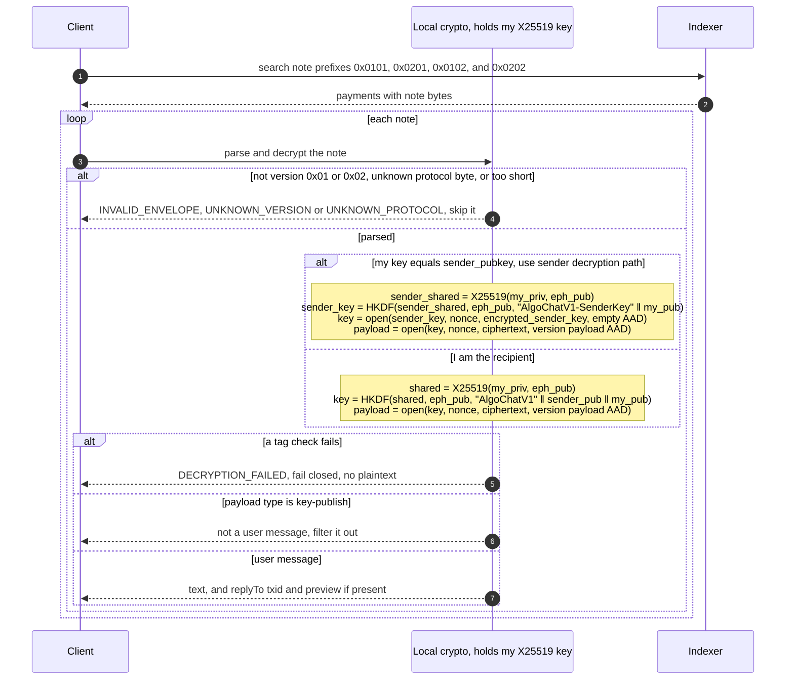

For version `0x02`, modifying any fixed-header or ciphertext byte makes payload authentication fail. Version `0x01` has empty AAD and does not authenticate every header field directly. In either version, an authentication failure makes `open` fail, and the client must return nothing rather than partial plaintext ([hi/encrypt.md](../hi/encrypt.md) `ENCRYPT-1.a`). [SECURITY.md](../SECURITY.md#recommendations) asks for the same error for every authentication failure.

### 4.4 Set up a PSK and send in mode `0x02`

PSK mode mixes a pre-shared secret into every message key, so reading a message needs **both** an X25519 private key **and** the PSK ([hi/psk.md](../hi/psk.md) `PSK-1`, [PROTOCOL.md §8](../PROTOCOL.md#8-psk-ratcheting-mode-protocol-0x02)). Setup follows the flow in [IMPLEMENTATION.md](../IMPLEMENTATION.md) (UI/UX Guidance).

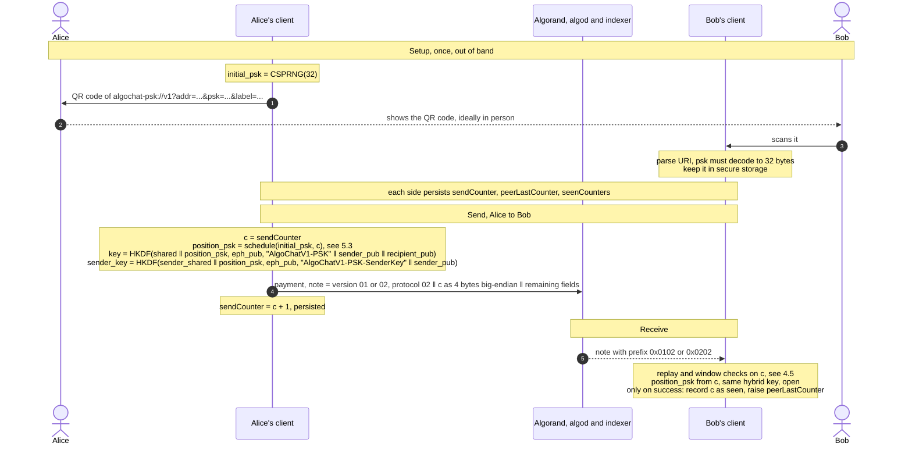

The sender reads its own PSK messages the same way as in 4.3, through `encrypted_sender_key`, and the counter checks apply only to messages received from the peer ([IMPLEMENTATION.md](../IMPLEMENTATION.md), PSK Message Decryption).

### 4.5 Accept or reject a PSK counter

Algorand can deliver notes out of order, so the receiver accepts any unseen counter inside a window around the highest counter seen so far ([PROTOCOL.md §8.5](../PROTOCOL.md#85-counter-window)).

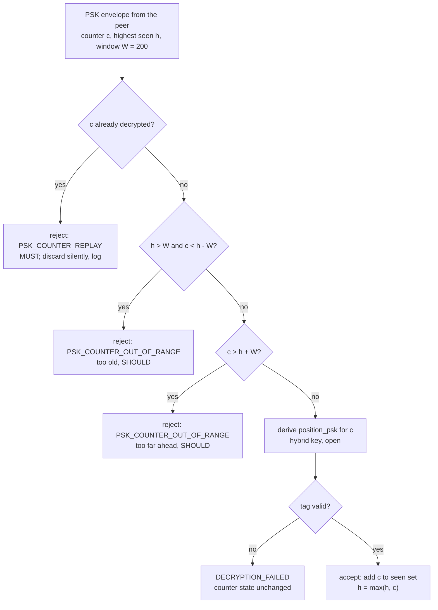

Test Case 4.4 in [TEST-VECTORS.md](../TEST-VECTORS.md#test-case-44-psk-counter-window) pins the edges: with `h = 50`, counters 0, 51 and 249 pass, 251 fails, and 50 fails if it was already decrypted.

### 4.6 Publish the status dashboard

This is the configured dashboard flow, separate from release qualification. It reports result artifacts from its configured jobs; it does not establish complete cross-language conformance or current-head security.

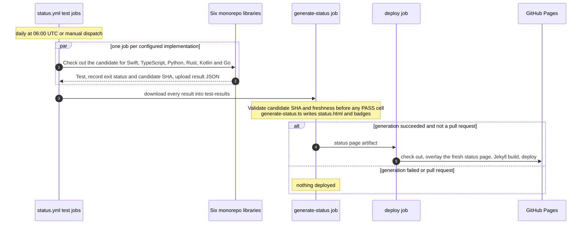

The current workflow tests all six monorepo libraries. Jobs record their actual exit status and candidate SHA and upload results even on failure. Generation runs after those jobs; the renderer checks the candidate SHA and a 36-hour freshness window before showing PASS, and rejects malformed or mismatched evidence. Missing results remain pending. Deployment requires successful generation and a non-PR event. These dashboard results remain separate from release qualification; the committed `status.html` and `badges/` are snapshots. See [ACCURACY.md](ACCURACY.md) for evidence boundaries.

### 4.7 Open a hybrid session (`0x04`, then `0x05`)

Everyday `0x01` and Extra lock `0x02` stay as above. A hybrid session is optional. The sender obtains a trusted recipient X25519 key and ML-KEM encapsulation key, then publishes one handshake note. Later messages reuse that session key in shorter data notes. Byte `0x03` is the public room administration record in [PROTOCOL.md](../PROTOCOL.md) section 5.8, not a hybrid session id. The hybrid byte layout is section 5.7.

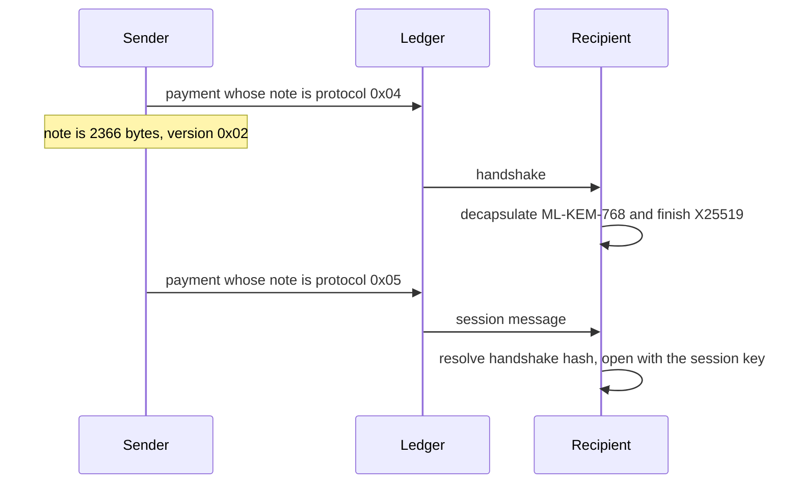

The sender can restore the session from the handshake using both sender long-term keys; the recipient restores it using both recipient long-term keys. Neither path needs the discarded ephemeral private key. This recoverability means there is no forward secrecy. High-level conversation clients do not automatically wire up this flow; low-level parity and application negotiation are separate concerns.

## 5. Data

### 5.1 Envelope byte layout

Offsets are from the deserializer in [IMPLEMENTATION.md](../IMPLEMENTATION.md) (Envelope Serialization). Ranges are half-open, `[start, end)`.

| Field | Standard `0x01` | PSK `0x02` | Size |
| --- | --- | --- | --- |
| `version` (`0x01` or `0x02`) | `[0]` | `[0]` | 1 |
| `protocol` | `[1]` = `0x01` | `[1]` = `0x02` | 1 |
| `ratchet_counter`, big-endian u32 | not present | `[2, 6)` | 4 |
| `sender_pubkey`, X25519 | `[2, 34)` | `[6, 38)` | 32 |
| `ephemeral_pubkey`, X25519 | `[34, 66)` | `[38, 70)` | 32 |
| `nonce` | `[66, 78)` | `[70, 82)` | 12 |
| `encrypted_sender_key`, 32-byte key + 16-byte tag | `[78, 126)` | `[82, 130)` | 48 |
| `ciphertext`, payload + 16-byte tag | `[126, end)` | `[130, end)` | variable |

| Limit | Standard | PSK |
| --- | --- | --- |
| Header | 126 bytes | 130 bytes |
| Smallest valid envelope (empty payload, tag only) | 142 bytes | 146 bytes |
| Largest envelope (Algorand note limit) | 4096 bytes | 4096 bytes |
| Largest plaintext payload | 3954 bytes | 3950 bytes |
| Note prefix for indexer filtering | `0x0101` or `0x0201` | `0x0102` or `0x0202` |

Hybrid session notes are separate from this table. A handshake is version `0x02` and protocol `0x04` (prefix `0x0204`, 2366 bytes). A session message is version `0x02` and protocol `0x05` (prefix `0x0205`). The sender copy on the handshake needs both X25519 and ML-KEM. Both layouts are specified in [PROTOCOL.md](../PROTOCOL.md) section 5.7.

### 5.2 Payload

Structured plaintext inside `ciphertext` is UTF-8 JSON; legacy raw UTF-8 text also remains readable ([PROTOCOL.md §9](../PROTOCOL.md#9-message-payload), [TEST-VECTORS.md §6](../TEST-VECTORS.md#6-message-payload-formats)):

| Shape | Fields | Client behaviour |
| --- | --- | --- |
| Text | `text` | Show it |
| Reply | `text`, `replyTo.txid`, `replyTo.preview` | Show it, linked to the earlier transaction |
| Key publish | `type: "key-publish"`; optional `publicKey` (base64) | Not a user message; filter it out |
| Legacy text | Raw UTF-8 | Preserve as message text |

The 3954 and 3950-byte limits apply to the encrypted plaintext, including any JSON overhead, so usable text in a structured payload is somewhat shorter. A plaintext of 882 bytes (standard) or 878 bytes (PSK) still fills a 1024-byte note. Those sizes remain valid and are no longer the maximum.

### 5.3 PSK key schedule

The "ratchet" is a deterministic two-stage schedule. Any counter's key can be computed directly from `initial_psk`, which is what makes out-of-order delivery work, and also why it is **not** forward secrecy ([PROTOCOL.md §8.1](../PROTOCOL.md#81-psk-ratchet-mechanism)).

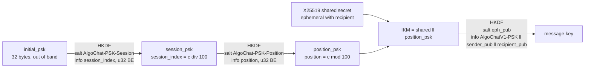

Leaking one `position_psk` exposes one message's PSK half; leaking a `session_psk` exposes up to 100; leaking `initial_psk` exposes every past and future PSK key for that pair. Test Cases 4.1 to 4.3 in [TEST-VECTORS.md](../TEST-VECTORS.md#4-psk-ratchet-derivation) pin the schedule and a full round trip.

### 5.4 Client-side state and on-chain objects

There is no database, smart contract or application state on chain. The chain stores only payment transactions; everything else lives on the client. The structures below are from [IMPLEMENTATION.md](../IMPLEMENTATION.md) (Data Structures, PSK Data Structures).

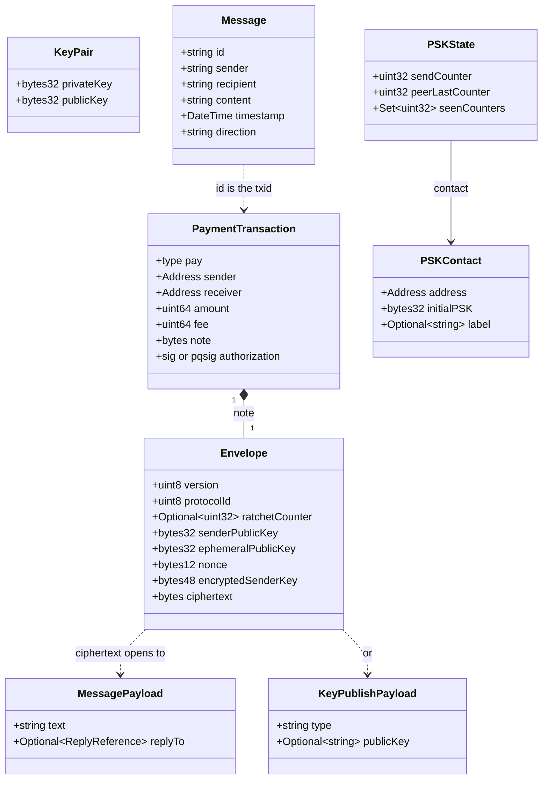

What must be kept, and where ([SECURITY.md](../SECURITY.md#key-management)):

- **Mnemonic and X25519 private key**: secure storage (secure enclave where available). The X25519 key can always be re-derived from the mnemonic.
- **`initial_psk`**: secure storage. It is the root of the whole PSK schedule.
- **PSK counter state** (`sendCounter`, `peerLastCounter`, `seenCounters`): **MUST** be persisted. Losing it weakens replay protection and can push counters outside the peer's window.
- **Hybrid ML-KEM private keys and cached session keys**: secure storage. Both long-term keys can reconstruct sessions from the original handshake; a leaked session key exposes that session.
- **Plaintext**: need not be stored. Both sides can re-decrypt from the chain.
- **Ephemeral private keys**: never stored.

## 6. Runtime and deployment

This repository contains the protocol documents and six language libraries. Protocol **1.6.0** and the library package versions are separate: Swift **1.6.0**, TypeScript **0.12.0**, Python **0.5.0**, Rust **0.6.0**, Kotlin **0.5.0**, and Go **0.5.0** (nested tag `go/v0.5.0`). See [the README version table](../README.md#versions-and-requirements) for package identities and [the release toolchain matrix](RELEASE.md#language-and-runtime-versions) for each language's requirements, configured CI versions, and unqualified minima. A package version in the source tree does not establish registry availability.

- **Versioning.** The specification version is stated at the top of [PROTOCOL.md](../PROTOCOL.md) and [TEST-VECTORS.md](../TEST-VECTORS.md). Protocol `1.1.0` added Extra lock (`0x02`), and `1.2.0` added Falcon-1024 accounts without an envelope change. `1.2.1` raised the note ceiling to 4096 bytes and added a fee surcharge for note bytes past 1024. `1.3.0` adds the hybrid handshake (`0x04`) and session message (`0x05`). `1.4.0` includes public room administration `0x03` and group mailbox notes `0x06` and `0x07`. `1.5.0` is the delta room note: member count 65535, 256 people in one room, and channels owned by the group owner. `1.6.0` adds room bots: `0x03` ops 13 (add bot) and 14 (set bot) carry a reply mode and a rate limit. These protocol ids, the accepted envelope versions `0x01`/`0x02`, and library package versions are distinct. Tag v1.3.0 does not include `0x03`. Tag v1.4.0 does.
- **Local checks.** `fledge lanes run verify` runs `validate` (`bun scripts/validate.ts`) and `release_checks` (`python3 -m unittest discover -s scripts/release -v`). `fledge run intent` runs `hi check`. `fledge trust verify` runs the whole trust gate.
- **Trust gate in CI.** [trust.yml](https://github.com/CorvidLabs/algochat/blob/main/.github/workflows/trust.yml) runs on pull requests and pushes to `main` that match its configured path filters. A workflow file does not establish the current branch-protection requirements.
- **Status dashboard.** [status.yml](https://github.com/CorvidLabs/algochat/blob/main/.github/workflows/status.yml) runs as in [§4.6](#46-publish-the-status-dashboard).
- **GitHub Pages.** Pages is built by workflow. The deploy job in `status.yml` runs `actions/jekyll-build-pages` with [_config.yml](https://github.com/CorvidLabs/algochat/blob/main/_config.yml) (theme `jekyll-theme-midnight`, kramdown with GFM input). [index.html](../index.html) is a hand-written landing page; the Markdown documents, including this one, are rendered by Jekyll; `status.html` and the badges are regenerated each run. [_includes/head-custom.html](https://github.com/CorvidLabs/algochat/blob/main/_includes/head-custom.html) loads Mermaid on pages that contain diagrams. The workflow publishes to the repository's configured GitHub Pages environment; the active public URL must be checked from a successful deployment. `status.yml` runs on its schedule or manual dispatch, so documentation pushes alone do not trigger publication.
- **Atlas.** `trust.yml` has an Atlas publication path to Pages, switched off in [.trust.toml](https://github.com/CorvidLabs/algochat/blob/main/.trust.toml).

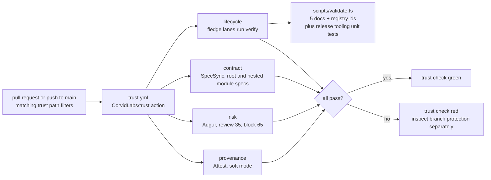

## 7. Security and trust boundaries

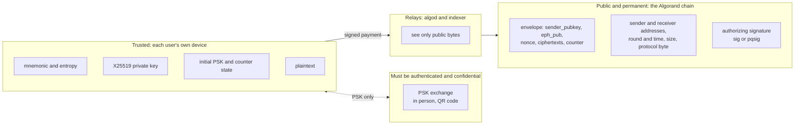

What is protected, and how:

| Property | Mechanism | Status |
| --- | --- | --- |
| Content confidentiality | Standard/PSK per-message X25519, optional hybrid X25519 + ML-KEM session, HKDF-SHA256, ChaCha20-Poly1305 | Protocol property; key and client assumptions apply ([hi/encrypt.md](../hi/encrypt.md) `ENCRYPT-1`) |
| Integrity | 16-byte Poly1305 tag on both ciphertexts; chain immutability | Protected, fails closed (`ENCRYPT-1.a`) |
| Replay | Identical signed transactions are unique; PSK protocol requires a counter window and seen set | New transactions can copy notes; per-port replay-state gaps remain |
| Who authorized the payment | Ed25519 `sig` or Falcon-1024 `pqsig` on the transaction | Protected; Falcon also resists quantum key recovery of the account |
| Quantum attack on the key exchange | PSK mixed into HKDF (`0x02`), or separate X25519 + ML-KEM-768 hybrid session | Requires secret PSK or secure hybrid assumptions; Falcon identity does **not** fix X25519 exchange ([hi/account.md](../hi/account.md) `ACCOUNT-2`) |
| Forward secrecy | None | **Not provided** ([§11.1](../PROTOCOL.md#111-forward-secrecy--not-provided), `HONEST-2`) |
| Metadata privacy, traffic analysis | None | **Not provided**: addresses, timing, size and mode are public (`HONEST-1`) |
| Deniability | None | **Not provided**: sender attribution is visible |

Things worth understanding before building on it:

- **No forward secrecy, retroactively and permanently.** The ephemeral key is the sender's, and its public half is in the envelope forever. Whoever later obtains either party's long-term X25519 key, or the mnemonic behind it, can decrypt every base-mode message that account ever sent or received. PSK-mode history additionally needs the PSK. Hybrid history needs both long-term encryption keys, which the mnemonic derives, or a leaked session key. Rotation cannot protect ciphertext that is already public ([PROTOCOL.md §11.1](../PROTOCOL.md#111-forward-secrecy--not-provided), [§11.4](../PROTOCOL.md#114-key-compromise)).
- **The sender's copy is separate.** Standard/PSK recipient decryption and sender-key recovery use separate derivations, but both reveal the same plaintext. Hybrid recipient and sender-copy recovery each require both long-term encryption keys for their path.
- **Sender authenticity comes from the payment, not the envelope.** The message key (§6.1) needs only the ephemeral private key and the recipient's public key, not the sender's long-term private key. What proves who sent a note is the transaction's authorizing signature, as [§10.2](../PROTOCOL.md#102-key-discovery) says, so the trustworthy "from" of a message is the transaction's sender address.
- **The PSK channel is the weak link in mode `0x02`.** If the PSK leaks during exchange, every PSK-derived key is exposed. Exchange in person or over an authenticated, confidential channel, and compare a fingerprint afterwards ([SECURITY.md](../SECURITY.md#for-users)).
- **Key handling.** Use audited libraries, a CSPRNG for ephemeral keys, nonces and PSKs, constant-time tag comparison, the same error for every authentication failure, and clear key material from memory after use ([SECURITY.md](../SECURITY.md#recommendations)).
- **Reporting.** Vulnerabilities go through a private GitHub Security Advisory, never a public issue ([SECURITY.md](../SECURITY.md#reporting-vulnerabilities)).

## 8. Failure modes and limits

| What goes wrong | Where it shows up | What happens |
| --- | --- | --- |
| Payload over 3954 bytes (3950 PSK, 4002 hybrid message) | Encrypt | `MESSAGE_TOO_LARGE` before a transaction is built; the protocol has no fragmentation, so the application must split |
| Note of 4097 bytes | Transport | Not a legal note; consensus rejects it |
| Envelope too short, wrong version, unknown protocol byte | Parse | `INVALID_ENVELOPE`, `UNKNOWN_VERSION`, `UNKNOWN_PROTOCOL`; the note is skipped |
| Tampered bytes, wrong key, wrong PSK or counter | Decrypt | `DECRYPTION_FAILED`; no plaintext is returned |
| Peer has never sent an AlgoChat payment and published no key | Discovery | `KEY_NOT_FOUND`; fall back to out of band |
| Fee below the scheme minimum plus the note surcharge (Falcon scheme minimum is 3 x min-fee), or any submit error | Transport | Rejected by consensus; `TRANSACTION_FAILED` |
| No PSK stored for this contact | PSK send or receive | `PSK_NOT_FOUND`; prompt the user to set one up |
| Counter older or further ahead than the window | PSK receive | `PSK_COUNTER_OUT_OF_RANGE`; warn about desync, recover state or exchange a new PSK |
| Counter already decrypted | PSK receive | `PSK_COUNTER_REPLAY`; discard silently, log for debugging |
| Lost counter state (reinstall, new device) | PSK send | Counters may land outside the peer's window; recover state from authenticated history or exchange a new PSK |

Error names are from [IMPLEMENTATION.md](../IMPLEMENTATION.md) (Error Handling, UI/UX Guidance). Other limits, from [README.md](../README.md) and [SECURITY.md](../SECURITY.md#known-limitations):

- **Latency** depends on network block inclusion and finality, plus indexer visibility. The protocol does not guarantee a fixed delivery time.
- **Cost** is the Algorand scheme minimum plus a surcharge for note bytes past 1024. At a 1,000 µAlgo min-fee, a note of 1024 bytes or fewer is 1,000 µAlgo (Ed25519) or 3,000 µAlgo (Falcon-1024). A 4096-byte note is 1,308 µAlgo (Ed25519) or 3,308 µAlgo (Falcon-1024). A 2000-byte Ed25519 note is 1,098 µAlgo. AlgoChat sets no fee of its own. See [PROTOCOL.md §10.3](../PROTOCOL.md#103-fees).
- **No deletion.** Messages are permanent.
- **One to one only.** Groups need one encryption per member or a protocol extension.
- **Discovery depth.** Current TypeScript discovery uses pages of 100 without a default depth cap when pagination is available; its non-paginated fallback uses a 1000-transaction batch. Adapters and explicit `maxDepth` can limit the search.
- **Dashboard.** Only collected result artifacts can be displayed; missing coverage and artifact paths limit its evidence. Failed tests do not necessarily stop the Pages deploy.

## 9. Decisions

The big choices, and where they are recorded:

| Decision | Why | Record |
| --- | --- | --- |
| The message is the note of a normal payment; no router contract | Direct messages go to the peer; group messages go to a mailbox address | [hi/send.md](../hi/send.md) `SEND-1`, [PROTOCOL.md §10.1](../PROTOCOL.md#101-algorand-transaction) |
| X25519 + HKDF-SHA256 + ChaCha20-Poly1305 | Widely audited primitives, the same family as Signal, WireGuard and TLS 1.3 | [PROTOCOL.md §3](../PROTOCOL.md#3-cryptographic-primitives) |
| A fresh ephemeral key for each standard/PSK message, plus a sender key wrap | Per-message key separation, and senders can re-read history from the chain on any device; hybrid messages reuse their handshake session key | [PROTOCOL.md §2](../PROTOCOL.md#2-design-goals), [§6.2](../PROTOCOL.md#62-sender-key-encryption-self-decryption) |
| Encryption keys derived from mnemonic entropy | Recoverable from the 25 words alone, and independent of the signing scheme | [PROTOCOL.md §4.1](../PROTOCOL.md#41-encryption-key-pair) |
| PSK as a new protocol byte `0x02`, purely additive | Old envelopes and vectors stay valid | [PROTOCOL.md §5.4](../PROTOCOL.md#54-protocol-identifiers), [§8](../PROTOCOL.md#8-psk-ratcheting-mode-protocol-0x02), [hi/psk.md](../hi/psk.md) |
| Deterministic PSK key schedule with a 200-counter window | Works with out-of-order delivery; the price is no forward secrecy and a 100-message session blast radius | [PROTOCOL.md §8.1](../PROTOCOL.md#81-psk-ratchet-mechanism), [SECURITY.md](../SECURITY.md#psk-known-limitations) |
| Falcon-1024 lives only at the account layer; import defaults to Ed25519 | Quantum-resistant payment authorization without moving existing wallets or changing envelopes | [PROTOCOL.md §4.3](../PROTOCOL.md#43-algorand-account-identity), [hi/account.md](../hi/account.md) |
| 1.2.1 raises the ceiling to 4,096 bytes without changing classical envelopes; 1.3 adds hybrid ids `0x04` and `0x05` | The earlier 1.2 account-agility change deferred PQ-KEM; the later hybrid contract is now in section 5.7. PQ multisig remains outside these envelopes | [PROTOCOL.md §14](../PROTOCOL.md#14-version-history), [§5.7](../PROTOCOL.md#57-hybrid-session-protocols-0x04-and-0x05) |
| Say plainly that there is no forward secrecy | Honesty about what the chain keeps forever | [hi/honest.md](../hi/honest.md) `HONEST-2`, [PROTOCOL.md §11.1](../PROTOCOL.md#111-forward-secrecy--not-provided), [.specsync/changes/](https://github.com/CorvidLabs/algochat/tree/main/.specsync/changes) |

## 10. Open questions found while writing this

The protocol contract and observed implementation behavior must be reviewed separately. [ACCURACY.md](ACCURACY.md) tracks the remaining gaps rather than treating passing structural checks as complete conformance.

- **Payload compatibility.** `publicKey` is optional in a key-publish marker; the X25519 key is also in the envelope header. Legacy raw UTF-8 remains readable alongside structured JSON.
- **Envelope validation.** Valid standard and PSK notes require at least 142 or 146 bytes, including the tag. Some ports perform only a header-size check; retain the stricter protocol requirement and fix the implementation gap.
- **PSK replay state.** The protocol requires counter-window and replay handling. Low-level crypto helpers and in-memory state do not prove persistence across restarts or full client integration.
- **Sender identity.** The decryption branch compares X25519 keys, while trustworthy sender identity comes from the transaction and the application's validated key binding. These are different checks; envelope fields alone cannot authenticate an Algorand address.
- **Hybrid integration.** All six libraries contain low-level hybrid helpers. Ordinary conversation APIs still need explicit hybrid selection, ML-KEM discovery, handshake submission and session restoration.
- **Qualification evidence.** The reported 2026-10-17 LocalNet runs and dashboard snapshots do not establish fresh candidate qualification, complete workflow coverage, package availability, or an independent security audit.

## 11. Glossary

| Term | Meaning |
| --- | --- |
| algod | An Algorand node's API: suggested transaction parameters, transaction submission |
| Envelope | The AlgoChat bytes placed in a payment's `note` |
| Ephemeral key | A fresh X25519 key pair for a standard/PSK message or hybrid handshake; its public half is stored in the note |
| Encrypted sender key | The message key sealed for the sender, so the sender can re-read their own message |
| Indexer | Algorand's query service; AlgoChat uses it to search by note prefix |
| Key publish | A self-addressed AlgoChat payment marked `type: "key-publish"`; separate raw X25519 and `ACPQ` announcements also exist |
| Hybrid session | A `0x04` X25519 + ML-KEM handshake and the `0x05` messages reusing its session key |
| Mnemonic entropy | The 32-byte secret behind a 25-word Algorand mnemonic; the IKM for AlgoChat keys |
| min-fee | Algorand's minimum transaction fee. PROTOCOL.md §10.3 prices examples at 1,000 µAlgo. The scheme minimum covers the first 1024 note bytes; later bytes add a surcharge |
| Note | The free-form bytes field of an Algorand transaction, 4,096 bytes at most. 4,097 bytes is not legal |
| `pqsig` | Algorand's native Falcon-1024 transaction signature, scheme `f1` |
| PSK | Pre-shared key: 32 random bytes two people share out of band for mode `0x02` |
| Ratchet counter | The 4-byte counter in a PSK envelope that picks the position key; a schedule index, not a Signal-style ratchet |
| Rekey | Pointing an Algorand address's spending authority at a different key, here Ed25519 to Falcon-1024 |
| Session and position PSK | The two stages of the PSK schedule: one key per 100 counters, then one per counter |
| `sig` | The classical Ed25519 transaction signature |
| µAlgo | One millionth of an ALGO |
