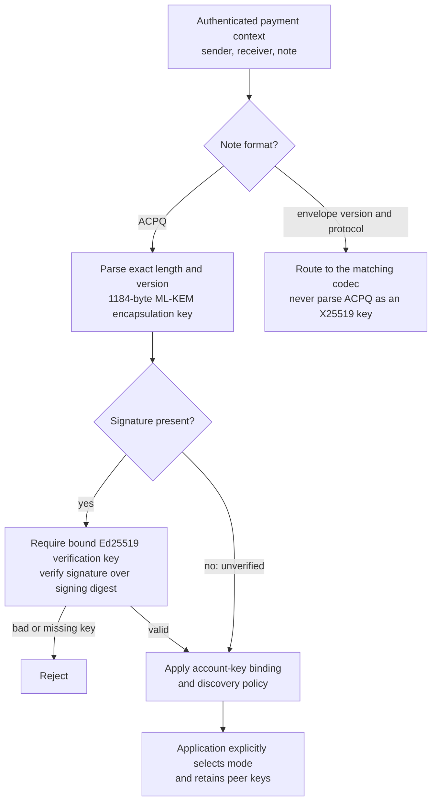
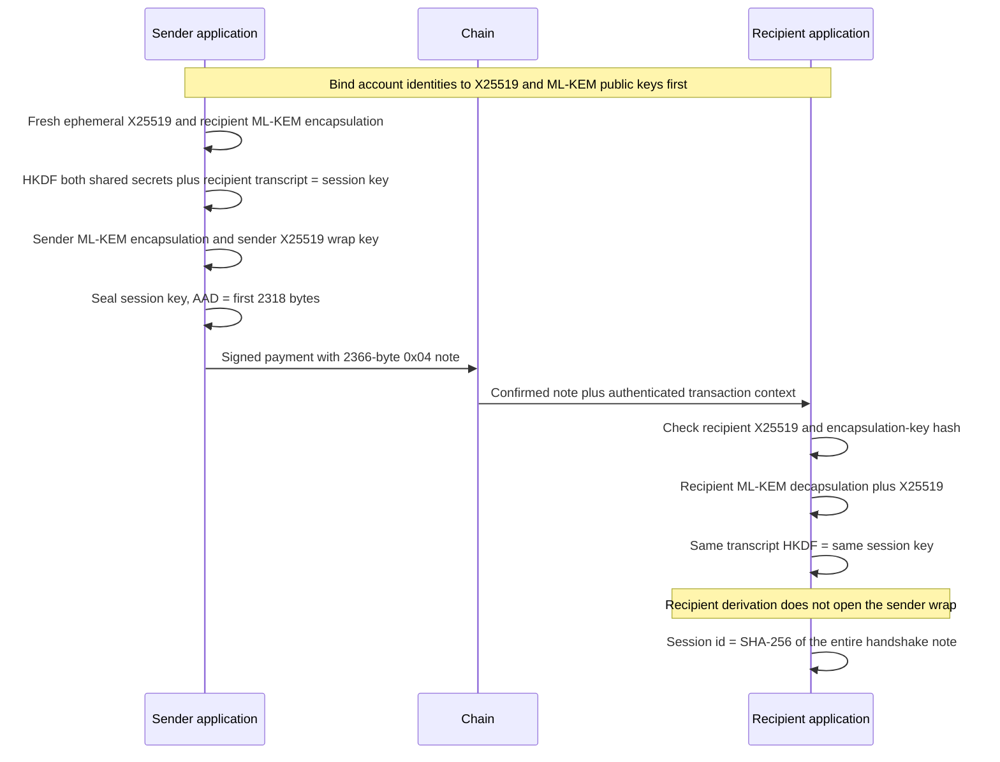
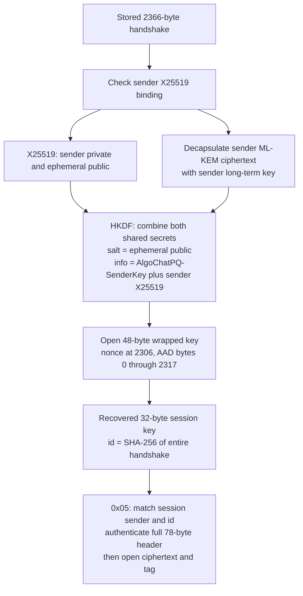
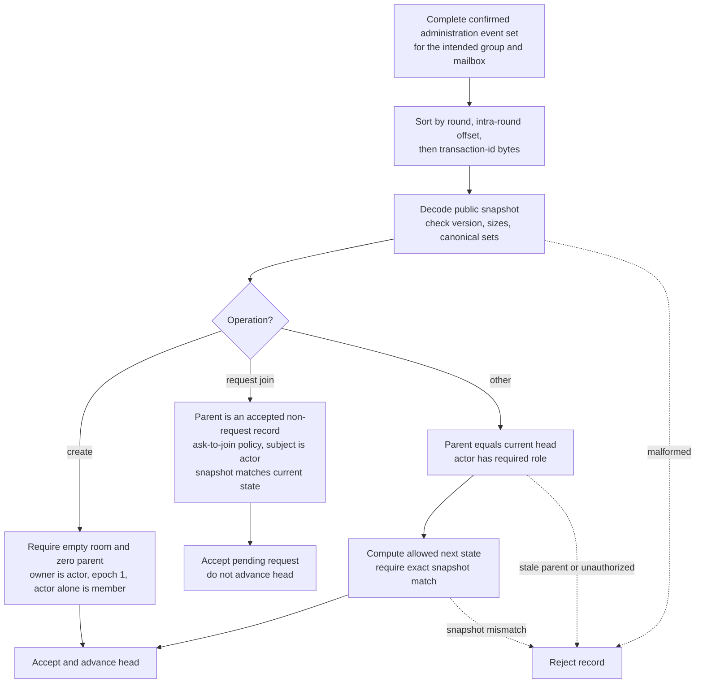
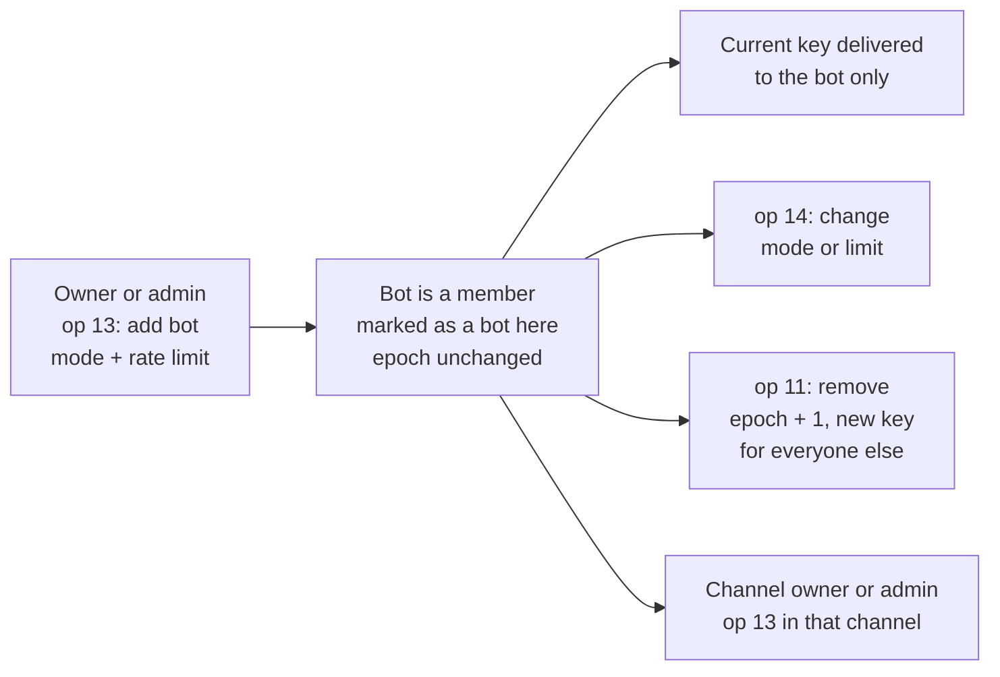
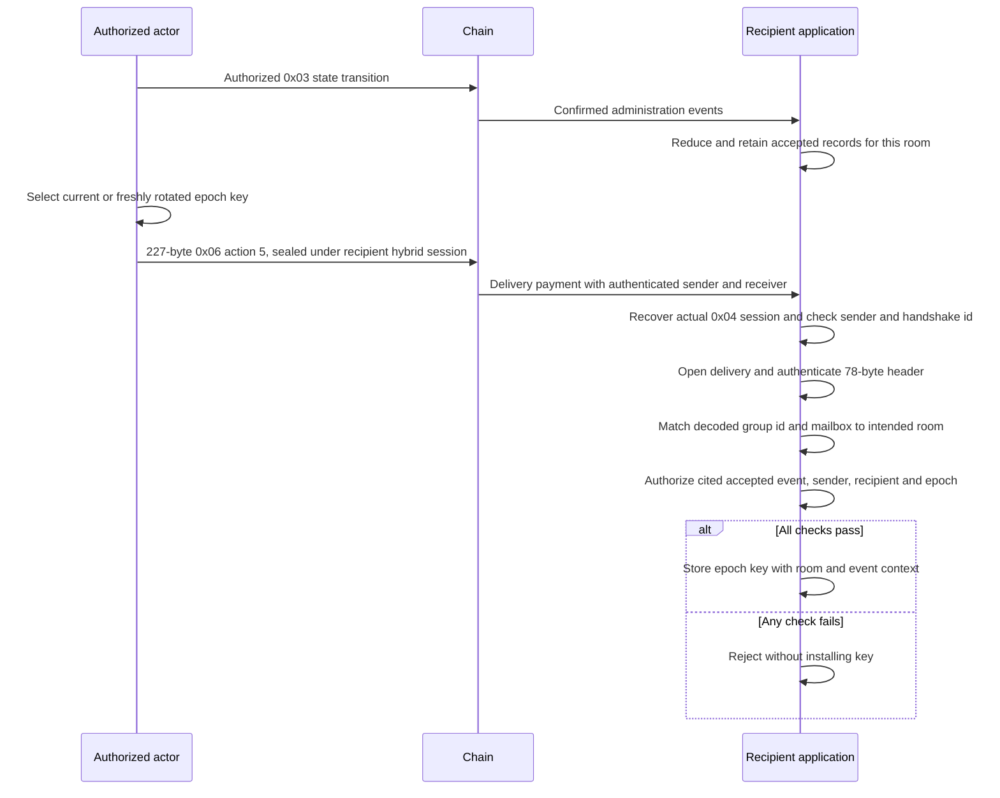
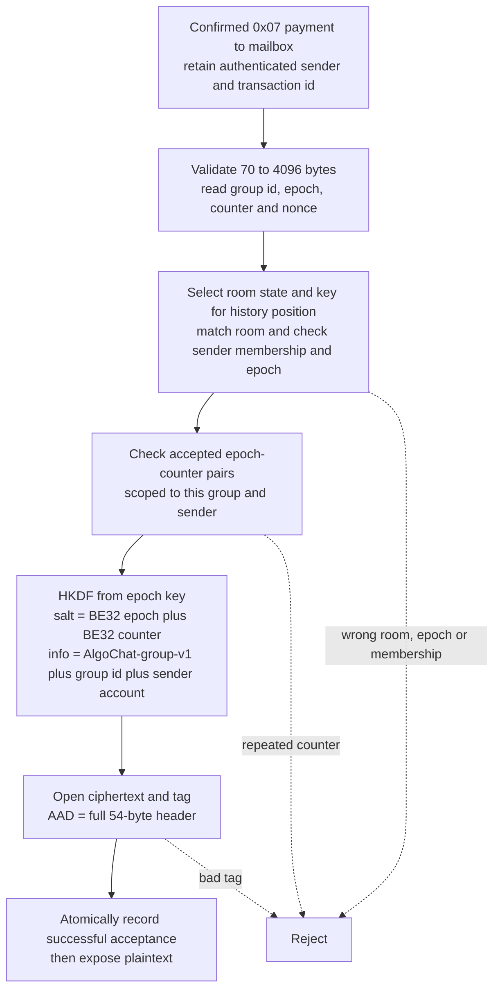

# Hybrid sessions and administered rooms

This guide describes protocol 1.6.0. It explains application integration; it does not claim a new runtime or LocalNet qualification. [PROTOCOL.md](../PROTOCOL.md) remains normative, with exact byte offsets in sections 5.7–5.8. Classical `0x01`/`0x02` behavior is unchanged. The protocol version, envelope version `0x02`, and library package versions are different concepts. Tag v1.4.0 includes `0x03`, `0x06`, and `0x07`. Tag v1.3.0 does not. A protocol tag does not by itself publish the Python, Rust, or Kotlin packages.

## Dispatch and discovery

Dispatch by **both** version and protocol. `0x0203` is public room administration; `0x0204` is a hybrid handshake; `0x0205` is a session message; `0x0206` is a private group-key delivery; `0x0207` is a group message to a mailbox. `ACPQ` is a separate announcement magic. Its version is `0x01`, and its exact size is 1189 bytes unsigned or 1253 bytes with an Ed25519 signature.

The signature digest is SHA-256 of UTF-8 `AlgoChat-pq-ek-v1` followed by the announcement version byte and encapsulation key. It does not contain an account address. Parsers receive a verification key from the caller; they do not establish the key's account binding or enforce the self-payment policy. An unsigned announcement remains unverified. Do not require the optional Ed25519 signature from a Falcon account as though its account address were an Ed25519 key. No high-level automatic hybrid negotiation is implied.

## Hybrid establishment and recipient recovery

ML-KEM-768 uses a 1184-byte encapsulation key, 1088-byte ciphertext and 32-byte shared secret. Account seed derivation produces `d || z` with two 32-byte HKDF outputs, salt `AlgoChat-v1-mlkem768`, infos `mlkem768-d` and `mlkem768-z`. The 2366-byte handshake includes two ML-KEM ciphertexts: one for the recipient and one for the sender's recovery path.

Recipient HKDF uses IKM `X25519 shared secret || recipient ML-KEM shared secret`, salt `algochat-pq-v1`, and info `algochat-pq-v1 || ephemeral public || recipient ML-KEM ciphertext || sender X25519 || recipient X25519 || SHA256(recipient encapsulation key)`. Labels are UTF-8, with no terminators. Output is 32 bytes. Neither successful derivation nor a claimed sender key in the note replaces the payment's authenticated sender and application key-binding policy.

## Sender recovery and session messages

Both parties can recover the same session from their long-term keys and the note. Subsequent `0x05` messages reuse that session key; there is no fresh session for every message, session expiry encoded on wire, forward-secret ratchet or built-in durable replay cache. Maximum plaintext is 4002 bytes; an empty message is 94 bytes. Use fresh nonces under a session key, including across `0x05` and `0x06`. Nonce reuse is unsafe even when their AAD differs.

## Public administration and membership

`0x03` carries a public snapshot and operation, not the room key. The actor is the payment sender; the receiver must be the room mailbox. The mailbox is excluded from the member/admin/owner sets. The application must validate that the transaction receiver equals the room mailbox **before** supplying events to the reducer: its event input has no receiver field. It supplies authenticated chain context, including raw transaction id, sender, confirmed round and intra-round offset.

Every accepted transaction id is replay-protected within the supplied reduction. Earlier valid head-advancing records win same-parent conflicts; clients recompute from the full ordered set. Join requests may cite an earlier accepted head, but must repeat the **current** state and cannot cite zero or another request. Public pending requests are derived, not stored in the snapshot. The [operation table](../PROTOCOL.md#582-room-administration-0x03) defines all fourteen operations and roles.

| Change | Epoch | Key handling by application |
| --- | --- | --- |
| Create | 1 | Creator generates key locally; no action-5 delivery authorized by create |
| Direct add or accept join | Unchanged | Current key delivered only to the new member |
| Remove, rekey or transfer owner | Increment; reject uint32 overflow | Generate a fresh key and deliver to remaining members |
| Name, policy, appoint/dismiss admin, request/decline join | Unchanged | No key delivery authorized by this record |
| Add bot (op 13) | Unchanged | Current key delivered only to the bot |
| Set bot (op 14) | Unchanged | No key delivery authorized by this record |

An add can reveal earlier messages in the same epoch because the key is unchanged. A remove cannot erase old keys or history. Role changes do not happen merely because a payment was signed or the mailbox spending key is held. Legacy `0x06` actions 1–4 create no administration chain or owner; their codecs do not enforce a stateful roster or epoch transition sequence.

## Bots in a room

Protocol 1.6.0 adds room bots. [PROTOCOL.md section 5.8.2](../PROTOCOL.md#582-room-administration-0x03) is normative; this is how they fit together.

- **Only the owner or an admin makes a bot.** Op 13 adds an account that is not yet a member and marks it as a bot in that room, with a reply mode and a rate limit. Nothing an account posts about itself makes it a bot, and a member who is already in the room cannot be marked later.
- **The settings live in the room record.** Op 13 and op 14 are delta notes with five more bytes after the parent group id: the reply mode (1 when mentioned or replied to, 2 every message, 3 its commands), then the most replies and the window in seconds, each big-endian and 1 through 65535. There is no default mode or limit. 5 replies per 60 seconds is a preset a client may suggest.
- **Every member can read the mode and limit.** The record is public, so any client can show them and check the bot against them.
- **A bot joins at once and is never an admin.** It does not request or accept. It cannot be appointed admin or given the room.
- **Each channel adds the bot separately.** A channel's owner or admin adds it there with its own op 13 and its own settings. The bot must already be a bot in the parent room. A plain add of that bot to a channel is rejected.
- **Removing a bot is a normal remove.** Op 11 drops the bot and its settings and raises the epoch, so the remaining members get a new key.

Whether a bot keeps to its rate limit is up to the bot. The Python agent in `py/` does; see [Run your own bot](../py/docs/run-your-own-bot.md).

## Authorized key delivery

The legacy `0x06` plaintext is 101 bytes and its note is 195 bytes. Administered action 5 appends a 32-byte administration transaction id, making the plaintext 133 bytes and the note 227 bytes. Both use the hybrid session key and full 78-byte header as AAD. Select the correct opener by framing; a legacy-only recognizer is not an action-5 recognizer.

`deliveryAuthorized` is separate from the opener. It does not compare the delivered group id/mailbox or prove chain provenance, and it does not require the cited event to be the current head. Supply the accepted history for the correct room and apply historical/current-key policy explicitly. Add/accept authorizes only the subject; remove authorizes remaining members except the subject; rekey/transfer authorizes all remaining members. The cited event's actor must equal the delivery's authenticated sender, and its epoch must match.

## Group-message acceptance

The sender account input is the raw 32-byte account public key, **not** the X25519 key. Maximum plaintext is 4026 bytes. Counters begin at zero per sender/epoch, increase without reuse, and must not wrap. The helper checks supplied accepted pairs but does not allocate or persist counters. Failed authentication must not consume replay state. Intentional rereading of an accepted transaction requires an application history policy distinct from accepting a copied note in a new transaction.

`senderMayPost` only checks membership and epoch against the state supplied by the caller. Retain appropriate historical state instead of testing every historical note against the latest room head. Any holder of the epoch key can derive any sender's message key; AEAD authentication alone is not proof of sender identity or membership. The authenticated payment sender supplies that boundary.

## Implementation boundaries

This is a source review of main `1400279`, not a fresh six-language test result or a security audit. Shared vectors exercise deterministic inputs; they do not independently establish network identity, actual session derivation, persistent storage or minimum-platform qualification.

| Library | Hybrid source | Group / administration source |
| --- | --- | --- |
| TypeScript | [session](../ts/src/pq/session.ts), [announcements](../ts/src/pq/announce.ts) | [group](../ts/src/pq/group.ts), [admin](../ts/src/pq/group-admin.ts) |
| Swift | [PQSession](../swift/Sources/AlgoChat/Crypto/PQSession.swift) | [GroupMailbox](../swift/Sources/AlgoChat/Crypto/GroupMailbox.swift), [GroupAdmin](../swift/Sources/AlgoChat/Crypto/GroupAdmin.swift) |
| Python | [pq](../py/src/algochat/pq.py) | [group](../py/src/algochat/group.py), [admin](../py/src/algochat/group_admin.py) |
| Rust | [pq](../rs/src/pq.rs) | [group](../rs/src/group.rs), [admin](../rs/src/group_admin.rs) |
| Kotlin | [PQ](../kt/src/main/kotlin/com/corvidlabs/algochat/PQ.kt) | [Group](../kt/src/main/kotlin/com/corvidlabs/algochat/Group.kt), [GroupAdmin](../kt/src/main/kotlin/com/corvidlabs/algochat/GroupAdmin.kt) |
| Go | [pq](../go/pq.go) | [group](../go/group.go), [admin](../go/group_admin.go) |

- All six provide the hybrid and group primitives; applications integrate discovery, transaction context, room authorization, key storage/rotation and durable replay handling. They do not all expose identical convenience APIs.
- Swift ML-KEM establishment/recovery requires Apple OS 26 APIs and is absent on Linux. Platform-independent hybrid message/combiner and group primitives can operate with supplied session material on Linux; that does not prove Linux ML-KEM support.
- Kotlin `Group.kt` uses signed `Int` validation: legacy membership epochs and `0x07` epochs must be 1 through 2147483647; counters must be 0 through 2147483647. `GroupAdmin.kt` represents full uint32 values as `Int` bit patterns for public administration/action-5 delivery. The normative uint32 range remains unchanged; the legacy/message limitation is a separate implementation issue.
- Inbound `0x05` notes over 4096 bytes are rejected by TypeScript, Go, Rust, Python and Kotlin after the merged parity fixes. Swift's `PQSession.isMessage` and `decrypt` still omit that upper-bound check; its sender enforces the 4002-byte plaintext maximum. Enforce the inbound ceiling in Swift integrations until a separate behavior fix lands. All six `0x07` openers enforce 70–4096 bytes.
- `0x05` decoded text handling differs: Python, Rust and Swift reject invalid UTF-8; TypeScript and Kotlin replace invalid sequences; Go preserves bytes in its string. Group-message APIs return bytes.
- Historical 1.3.0 and group LocalNet reports remain [reported evidence](../PARITY.md), not a current-head rerun. Frozen vector bytes are unchanged. See [TEST-VECTORS.md](../TEST-VECTORS.md#coverage-boundaries) for what each fixture establishes.
