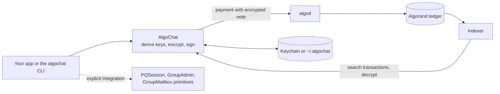

# Swift

The Swift package manifest is at the root of [CorvidLabs/algochat](https://github.com/CorvidLabs/algochat). The package name is `algochat`. The product is `AlgoChat`. CI is the monorepo Swift workflow. The archived swift-algochat repository remains at tag `0.4.0` for apps that have not switched the URL.

> **Security Notice**: This library has not been independently audited. While it uses well-established cryptographic primitives from [swift-crypto](https://github.com/apple/swift-crypto), use in production is at your own risk.

Encrypted peer-to-peer messaging on the Algorand blockchain. Built with Swift 6 and async/await. PQ levels are integers 0 through 5 in [PROTOCOL.md section 5.4.2](../PROTOCOL.md#542-pq-levels). Everyday `0x01` is level 0, Extra lock `0x02` is level 1, and hybrid `0x04` and `0x05` are level 3. Room administration `0x03` is public and has no PQ level.

## Version and requirements

- Package: `algochat`, product `AlgoChat`, **1.6.1** via repository tag **`v1.6.1`**, implementing protocol **1.6.0**. The Swift sources did not change in 1.6.1, so `from: "1.6.0"` still resolves to it. The archived repository's **0.4.0** tag belongs to the previous distribution. Tag **`v1.6.0`** is the previous monorepo release.
- [Root manifest](../Package.swift): Swift tools **6.0+**; iOS **15+**, macOS **12+**, tvOS **15+**, watchOS **8+**, and visionOS **1+**.
- Hybrid ML-KEM methods require Apple OS **26** APIs. Qualification covers **macOS 26** and a separate Linux build without ML-KEM; exact runner compiler versions are recorded in receipts. Older platform minima are unqualified. See [all language versions and qualification limits](../docs/RELEASE.md#language-and-runtime-versions).

## Features

- **End-to-End Encryption** - X25519 key agreement + ChaCha20-Poly1305
- **No forward secrecy** - A long-term key opens that account's past messages. A fresh ephemeral key only separates message keys.
- **Quantum Defense-in-Depth** - Optional ratcheting PSK mode (protocol v1.1) provides hybrid X25519 + pre-shared key encryption
- **PSK Replay Controls** - The configured PSK manager checks and records received counters. Reading the same transaction again returns that message. A copied note under a new transaction id is refused, and a failed decryption records nothing. The send counter does not wrap. Standard mode has no cryptographic replay check
- **Immutable Messages** - Permanently recorded on-chain
- **Decentralized** - No central server controls delivery
- **Bidirectional Decryption** - Both sender and recipient can decrypt messages
- **Reply Support** - Thread conversations with reply context
- **Biometric Storage** - Protect encryption keys with Face ID / Touch ID
- **Cross-Implementation** - Shared protocol fixtures with the [other implementations](../README.md); client and platform capabilities differ
- **Multi-Platform** - iOS 15+, macOS 12+, tvOS 15+, watchOS 8+, visionOS 1+. The hybrid ML-KEM session needs macOS 26. Linux builds the library without those methods, because swift-crypto has no `MLKEM768` there.

## Installation

### Swift Package Manager

Add AlgoChat to your `Package.swift`:

The package manifest is at the root of [CorvidLabs/algochat](https://github.com/CorvidLabs/algochat).

```swift
dependencies: [
    .package(url: "https://github.com/CorvidLabs/algochat.git", from: "1.6.0")
]
```

Then add the dependency to your target:

```swift
.target(
    name: "YourApp",
    dependencies: [
        .product(name: "AlgoChat", package: "algochat")
    ]
)
```

Or add it via Xcode:
1. File > Add Package Dependencies
2. Enter: `https://github.com/CorvidLabs/algochat.git`

## Quick Start

### Creating a Chat Client

```swift
import AlgoChat
import Algorand

// Create a new account
let account = try Account()

// Initialize chat client
let chat = try await AlgoChat(network: .testnet, account: account)
```

### Sending Messages

```swift
// Start a conversation
let recipient = try Address(string: "RECIPIENT_ADDRESS_HERE")
let conversation = try await chat.conversation(with: recipient)

// Send a message (wait for confirmation)
try await chat.send("Hello!", to: conversation, options: .confirmed)

// Send with indexer confirmation (guarantees visibility on refresh)
try await chat.send("Hello!", to: conversation, options: .indexed)

// Send a reply
if let lastMessage = conversation.lastReceived {
    try await chat.send("Thanks!", to: conversation, options: .replying(to: lastMessage))
}
```

### Fetching Messages

```swift
// Get all conversations
let conversations = try await chat.conversations()

// Refresh a specific conversation
let updated = try await chat.refresh(conversation)

// Access messages
for message in updated.messages {
    print("\(message.direction): \(message.content)")
}

// Filter by direction
let received = updated.receivedMessages
let sent = updated.sentMessages
```

### Publishing Your Key

Allow others to message you before you've sent them a message:

```swift
try await chat.publishKeyAndWait()
```

### PSK Mode (Quantum Defense-in-Depth)

PSK mode adds a pre-shared key layer on top of standard ECDH encryption, providing defense-in-depth against future quantum attacks on key exchange.

```swift
import Foundation
import Crypto
import Algorand

// Generate 32 bytes with the cryptographic library's secure random generator.
let sharedPSK = SymmetricKey(size: .bits256).withUnsafeBytes { Data($0) }
let pskStorage = try FilePSKStorage(directoryName: ".algochat")
let pskChat = try await AlgoChat(network: .testnet, account: account, pskStorage: pskStorage)

// Send this URI through a confidential out-of-band channel.
let exchange = await pskChat.generatePSKExchangeURI(psk: sharedPSK, label: "Alice")
let uri = exchange.toString()

// On Bob's client, use separate local storage and import Alice's URI.
let bobAccount = try Account()
let bobAddress = bobAccount.address
let bobStorage = try FilePSKStorage(directoryName: ".algochat-bob")
let bobChat = try await AlgoChat(network: .testnet, account: bobAccount, pskStorage: bobStorage)
let received = try PSKExchangeURI.parse(uri)
try await bobChat.addPSKContact(uri: received)

// On Alice's client, add Bob using the same shared bytes and send.
try await pskChat.addPSKContact(address: bobAddress.description, psk: sharedPSK, label: "Bob")
// Fund both accounts; Bob must publish his key and wait for indexer visibility
// (or already have a discoverable message) before Alice can send.
let conversation = try await pskChat.conversation(with: bobAddress)
try await pskChat.sendPSK("Hello with PSK!", to: conversation)
```

## Core Concepts

### Encryption

Messages are encrypted using modern cryptographic primitives:

- **Key Agreement**: X25519 elliptic curve Diffie-Hellman
- **Encryption**: ChaCha20-Poly1305 authenticated encryption
- **Key Derivation**: HKDF-SHA256 with domain separation
- **Key separation**: A fresh ephemeral key per everyday message. This is not forward secrecy.

### Message Envelope Formats

**Standard Mode** (protocol `0x01`):

```
[version: 1][protocol: 1][sender_pubkey: 32][ephemeral_pubkey: 32][nonce: 12][encrypted_sender_key: 48][ciphertext: variable]
```

- **Header size**: 126 bytes
- **Maximum message**: 3954 bytes (after encryption overhead)

**PSK Ratcheting Mode** (protocol `0x02`):

```
[version: 1][protocol: 2][ratchet_counter: 4][sender_pubkey: 32][ephemeral_pubkey: 32][nonce: 12][encrypted_sender_key: 48][ciphertext: variable]
```

- **Header size**: 130 bytes
- **Maximum message**: 3950 bytes (after encryption overhead)

The Swift standard and PSK encryptors write envelope version `0x01` (empty payload associated data). Decoders also accept version `0x02`, which authenticates the full 126-byte or 130-byte header. The field labeled `version: 1` above has a width of one byte. See the [protocol](../PROTOCOL.md).

### Low-Level Hybrid Sessions

`PQSession` exposes an X25519 + ML-KEM-768 handshake (protocol `0x04`, 2366 bytes), sender recovery, and session-data encryption/decryption (protocol `0x05`, a 78-byte header and 4002-byte plaintext maximum). `PQAnnouncement` encodes and parses `ACPQ` encapsulation-key announcements. These APIs are separate from the `AlgoChat` client's send, discovery and indexer flows: applications must transport notes, retain session state and apply replay policy. ML-KEM key creation and handshake methods require Apple OS 26 and are omitted on Linux; the non-ML-KEM helpers remain available.

### Key Storage

```swift
// Load a previously stored key on iOS, macOS or visionOS.
let storage = KeychainKeyStorage()
let chatAccount = try await ChatAccount(account: account, storage: storage)

// Password-encrypted file storage (Linux/cross-platform)
let fileStorage = FileKeyStorage(password: "secret") // ~/.algochat/keys/
```

On iOS, macOS and visionOS, `KeychainKeyStorage.store(..., requireBiometric: true)` requests user-presence access control; these are generic-password Keychain items, not Secure Enclave private keys. On tvOS, watchOS and Linux this type falls back to process memory. `FilePSKStorage` stores PSKs and counter state as plaintext JSON, so applications must protect the storage directory. Accepted storage and decode requirements that exceed current behavior are tracked in [implementation gaps](../docs/ACCURACY.md).

### Send Options

```swift
// Fire-and-forget (fastest)
try await chat.send("Hello!", to: conversation)

// Wait for blockchain confirmation
try await chat.send("Hello!", to: conversation, options: .confirmed)

// Wait for indexer (guarantees visibility)
try await chat.send("Hello!", to: conversation, options: .indexed)
```

## Architecture

The diagram below shows the classical high-level client path. Current source also exposes low-level `0x03` administration, `0x04`/`0x05` hybrid sessions, `0x06` key delivery and `0x07` group messages. Applications integrate those primitives explicitly; see the [complete protocol flows](../docs/PROTOCOL-FLOWS.md). The group protocols are in tag v1.4.0. They were not in tag v1.3.0.

There is no AlgoChat server. The library encrypts on your device, carries the envelope in the note of an Algorand payment, and reads it back through an indexer.



The [high-level design](docs/HLD.md) covers the package targets, the protocol and wire formats, the send, receive, key-discovery and PSK flows as sequence diagrams, local storage, CI and releases, the trust model, and known limits.

## CLI Tool

The package includes an interactive command-line interface:

```bash
swift run algochat
```

## Testing

### Unit Tests

```bash
swift test
```

### Integration Tests (LocalNet)

```bash
# Start local Algorand network
algokit localnet start

# Run integration tests
swift test --filter "LocalnetIntegration"

# Stop localnet
algokit localnet stop
```

## Requirements

- Swift 6.0+
- iOS 15.0+ / macOS 12.0+ / tvOS 15.0+ / watchOS 8.0+ / visionOS 1.0+
- Hybrid ML-KEM methods require iOS 26 / macOS 26 / tvOS 26 / watchOS 26 / visionOS 26 / Mac Catalyst 26. Qualification covers macOS 26; the Linux lane builds without those methods.
- [AlgoKit CLI](https://github.com/algorandfoundation/algokit-cli) (optional, for localnet testing)

## Security

See [SECURITY.md](SECURITY.md) for:
- Cryptographic guarantees
- Threat model
- Key management details

## License

MIT License - See [LICENSE](../LICENSE) file for details.

## Resources

- [swift-algorand](https://github.com/CorvidLabs/swift-algorand) - Algorand SDK for Swift
- [swift-algokit](https://github.com/CorvidLabs/swift-algokit) - High-level Algorand toolkit
- [Algorand Developer Portal](https://developer.algorand.org)
