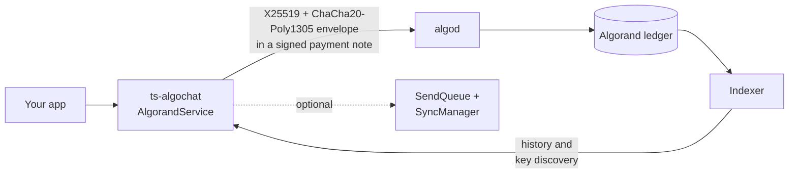

# ts-algochat

[](https://github.com/CorvidLabs/algochat/actions/workflows/ts.yml)
[](../LICENSE)
[](package.json)

> **Pre-1.0 Notice**: This library is under active development. The API may change between minor versions until 1.0.

PQ levels for `0x01`, `0x02`, `0x04`, and `0x05` are in [PROTOCOL.md section 5.4.2](../PROTOCOL.md#542-pq-levels). `0x03` is not assigned.

TypeScript implementation of the AlgoChat protocol for encrypted messaging on Algorand.

## Version and requirements

- Package: `@corvidlabs/ts-algochat` **0.9.0**, implementing protocol **1.3.0**.
- [Declared runtime](package.json): Node.js **18.0.0+**. Development uses TypeScript **`^5.7.0`**, resolved by the Bun lockfile.
- Qualification is configured for **Node.js 22** and **Bun 1.3.6**; Node.js 18 remains unqualified. See [all language versions and qualification limits](../docs/RELEASE.md#language-and-runtime-versions).

## Features

- **End-to-End Encryption** - X25519 + ChaCha20-Poly1305
- **Per-Message Key Separation** - Fresh ephemeral key pair per message (this is *not* forward secrecy — see [Security Properties](#security-properties))
- **PSK Mode (v1.1)** - Hybrid ECDH + pre-shared key ratcheting for quantum defense-in-depth
- **Bidirectional Decryption** - Sender can decrypt own messages
- **Reply Support** - Thread conversations with context
- **Minimal Dependencies** - Uses @noble/curves and @noble/hashes, plus @noble/post-quantum 0.7.1 (no independent audit), algosdk 3.7, and falcon-1024
- **Falcon-1024 accounts** - New identities sign with `pqsig` by default. Import without a scheme still recovers Ed25519
- **4096-byte notes** - Standard plaintext up to 3954 bytes, PSK plaintext up to 3950 bytes. Notes past 1024 bytes pay the consensus fee surcharge
- **TypeScript First** - Full type safety

## Security Properties

| Property | Status |
|----------|--------|
| Message content confidentiality | Protected (E2EE) |
| Message integrity | Protected (authenticated encryption) |
| Forward secrecy | **Not provided** — standard history is exposed by the relevant X25519 key; PSK also needs the shared secret; hybrid sessions need both hybrid private keys or the session key |
| Replay attacks | PSK counter helpers reject repeats when the application preserves and checks state; standard mode has no cryptographic replay check |
| Quantum resistance (key exchange) | Optional PSK defense-in-depth or low-level X25519 + ML-KEM-768 sessions |
| Quantum resistance (account identity) | Optional (Falcon-1024 `pqsig` on new accounts) |
| PSK session forward secrecy | **Not provided** — the position-key schedule is deterministic from a static initial PSK, so holding it yields all past and future keys |
| Metadata privacy | **Not protected** (addresses, timing visible) |
| Traffic analysis | **Not protected** |

> **On forward secrecy.** Standard-mode message keys derive as
> `X25519(recipient_private_key, envelope.ephemeral_public_key)`, and the ephemeral
> public key is carried in the envelope, which lives permanently and publicly on the
> Algorand blockchain. Compromise of the relevant long-term X25519 key exposes that
> account's standard-mode history. PSK mode additionally requires the initial PSK.
> Hybrid sender/recipient recovery requires both the relevant X25519 and ML-KEM
> private keys, or an exposed session key. An account recovery phrase can derive
> both account-based hybrid keys. None of these modes provides forward secrecy. See
> [PROTOCOL.md §11.1](https://github.com/CorvidLabs/algochat/blob/main/PROTOCOL.md#111-forward-secrecy--not-provided).

## Installation

The package's configured registry is GitHub Packages. Set `@corvidlabs:registry=https://npm.pkg.github.com` in your npm configuration and authenticate with a token that has `read:packages`. The source version above does not by itself confirm publication; see [the release record](../docs/RELEASE.md#package-versions-and-distribution).

```bash
# npm
npm install @corvidlabs/ts-algochat@0.9.0

# bun
bun add @corvidlabs/ts-algochat@0.9.0

# pnpm
pnpm add @corvidlabs/ts-algochat@0.9.0
```

## Quick Start

```typescript
import {
    AlgorandService,
    createChatAccountFromMnemonic,
    createRandomChatAccount,
} from '@corvidlabs/ts-algochat';

// Initialize service
const service = new AlgorandService({
    algodToken: '',
    algodServer: 'https://testnet-api.algonode.cloud',
    indexerToken: '',
    indexerServer: 'https://testnet-idx.algonode.cloud',
});

// Create a new Falcon-1024 account (default)
const { account, mnemonic } = createRandomChatAccount();

// Import a classical 25-word phrase (Ed25519 address, same as Pera / v1.1)
const imported = createChatAccountFromMnemonic('your 25 word mnemonic...');

// Recover a Falcon account generated from the same words
const falcon = createChatAccountFromMnemonic(mnemonic, { scheme: 'falcon-1024' });

// Discover recipient's encryption key
const recipientKey = await service.discoverPublicKey('RECIPIENT_ADDRESS');

// Send encrypted message
const result = await service.sendMessage(
    account,
    'RECIPIENT_ADDRESS',
    recipientKey,
    'Hello from AlgoChat!'
);

console.log('Transaction ID:', result.txid);

// Fetch messages
const messages = await service.fetchMessages(account, 'RECIPIENT_ADDRESS');
```

## API Reference

### Account Management

```typescript
// Create from mnemonic (Ed25519 unless scheme is passed)
const account = createChatAccountFromMnemonic('word1 word2 ...');

// Generate a new Falcon-1024 account
const generated = createRandomChatAccount();
console.log('Address:', generated.account.address);
console.log('Scheme:', generated.account.scheme);
console.log('Mnemonic:', generated.mnemonic);

// Validate mnemonic
if (validateMnemonic('word1 word2 ...')) {
    // Valid 25-word mnemonic
}

// Validate address
if (validateAddress('ALGO...')) {
    // Valid Algorand address
}
```

### Sending Messages

```typescript
// Simple message
await service.sendMessage(account, recipient, recipientKey, 'Hello!');

// Reply to a message
await service.sendReply(account, recipient, recipientKey, 'Reply text', {
    messageId: 'original-tx-id',
    preview: 'Original message preview...',
});
```

### Fetching Messages

```typescript
// Get all messages with an address
const messages = await service.fetchMessages(account, 'ADDRESS');

// Get all conversations
const conversations = await service.fetchConversations(account);

// Discover public key
const pubKey = await service.discoverPublicKey('ADDRESS');
```

### Low-Level Crypto

```typescript
import {
    deriveEncryptionKeys,
    encryptMessage,
    decryptMessage,
    encodeEnvelope,
    decodeEnvelope,
} from '@corvidlabs/ts-algochat';

// Derive keys from seed
const keys = deriveEncryptionKeys(seed);

// Encrypt message
const envelope = encryptMessage(
    'Hello!',
    senderPublicKey,
    recipientPublicKey
);

// Encode for transmission
const bytes = encodeEnvelope(envelope);

// Decode received envelope
const decoded = decodeEnvelope(bytes);

// Decrypt message
const content = decryptMessage(decoded, myPrivateKey, myPublicKey);
```

## Types

```typescript
interface ChatAccount {
    address: string;
    scheme: 'ed25519' | 'falcon-1024';
    account?: algosdk.Account; // Ed25519 only
    encryptionKeys: X25519KeyPair;
    ed25519PublicKey: Uint8Array;
    txnSigner: algosdk.TransactionSigner;
}

interface Message {
    id: string;
    sender: string;
    recipient: string;
    content: string;
    timestamp: Date;
    confirmedRound: number;
    direction: 'sent' | 'received';
    replyContext?: ReplyContext;
}

interface Conversation {
    participant: string;
    participantPublicKey?: Uint8Array;
    messages: Message[];
    lastMessage?: Message;
}
```

## Architecture

Messages travel as encrypted notes on ordinary Algorand payments. The library encrypts and signs locally, submits through algod, and rebuilds conversations from the indexer. There is no server or contract in between.



The [high-level design](docs/HLD.md) covers the modules, wire formats, send, receive, key-discovery, sync and PSK flows, trust boundaries and limits. The former standalone repository's documentation site is historical; current build and release configuration lives in this monorepo.

## Protocol

This package includes [AlgoChat protocol 1.3.0](../PROTOCOL.md) standard (`0x01`), PSK (`0x02`), hybrid handshake (`0x04`) and session-data (`0x05`) primitives. New standard and PSK encryptions write envelope version `0x02`, authenticating the fixed header as associated data; reads also accept legacy version `0x01`. Falcon account signatures and hybrid message encryption are separate capabilities.

### Wire Format (v1.0 Standard)

```
[version: 1][protocol: 1][sender_pubkey: 32][ephemeral_pubkey: 32][nonce: 12][encrypted_sender_key: 48][ciphertext: variable]
```

### Wire Format (v1.1 PSK)

```
[version: 1][protocol: 2][ratchet_counter: 4][sender_pubkey: 32][ephemeral_pubkey: 32][nonce: 12][encrypted_sender_key: 48][ciphertext: variable]
```

### Cryptographic Primitives

| Function | Algorithm |
|----------|-----------|
| Key Agreement | X25519 ECDH |
| Encryption | ChaCha20-Poly1305 |
| Key Derivation | HKDF-SHA256 |

## PSK v1.1 Protocol

The PSK (Pre-Shared Key) v1.1 protocol adds an additional layer of authentication and security on top of standard ECDH encryption by incorporating a pre-shared key into the key derivation process.

### Features

- **Two-level key schedule** - Session keys derived per 100 messages, position keys per message (deterministic from the initial PSK, not a forward-secret ratchet)
- **Hybrid encryption** - Combines the ECDH shared secret with the PSK, so an attacker must obtain both
- **Replay controls** - Applications call `validateCounter` before decryption and `recordReceive` after authentication, and persist the resulting state
- **Out-of-band key exchange** - URI scheme for sharing PSK keys (QR code compatible)

### Quantum Defense-in-Depth

PSK mode provides defense against future quantum attacks through **hybrid key derivation**:

```
symmetricKey = HKDF(
  ikm = ephemeralECDH || currentPSK,
  salt = ephemeralPublicKey,
  info = "AlgoChatV1-PSK" || senderPubKey || recipientPubKey
)
```

The encryption key is derived from **both** the ephemeral ECDH shared secret and the ratcheted PSK, concatenated before HKDF. This means an attacker must break **both** layers:

1. **ECDH only broken** (quantum computer): Attacker still needs the PSK
2. **PSK only compromised**: Attacker still cannot break ECDH (per-message ephemeral keys)
3. **Both compromised**: Only then can messages be decrypted

This hybrid approach ensures that even if quantum computers eventually break X25519 ECDH, messages encrypted with PSK mode remain secure as long as the pre-shared key was exchanged securely.

### Two-Level Ratcheting

PSK mode derives per-message keys using a two-level ratchet:

1. **Session derivation**: `sessionPSK = HKDF(initialPSK, sessionIndex)` where `sessionIndex = counter / 100`
2. **Position derivation**: `currentPSK = HKDF(sessionPSK, position)` where `position = counter % 100`

This creates 100-message session boundaries. Compromising a session PSK exposes at most 100 messages.

### Exchange URI Format

PSK exchange URIs are designed for QR code sharing:

```
algochat-psk://v1?addr=<algorand_address>&psk=<base64url>&label=<optional>
```

Use any QR library (e.g., `qrcode`) to encode the URI for easy scanning between devices.

### Usage

```typescript
import {
    derivePSKAtCounter,
    encryptPSKMessage,
    decryptPSKMessage,
    encodePSKEnvelope,
    decodePSKEnvelope,
    isPSKMessage,
    createPSKState,
    advanceSendCounter,
    validateCounter,
    recordReceive,
    createPSKExchangeURI,
    parsePSKExchangeURI,
} from '@corvidlabs/ts-algochat';

// Derive PSK for a specific counter
const psk = derivePSKAtCounter(sharedSecret, counter);

// Encrypt a PSK message
const envelope = encryptPSKMessage(
    'Hello with PSK!',
    senderPublicKey,
    recipientPublicKey,
    psk,
    counter,
);

// Encode for transmission
const bytes = encodePSKEnvelope(envelope);

// Check if received data is a PSK message
if (isPSKMessage(bytes)) {
    const decoded = decodePSKEnvelope(bytes);
    const content = decryptPSKMessage(decoded, myPrivateKey, myPublicKey, psk);
}

// Counter state management
let state = createPSKState();
const { counter: sendCounter, state: newState } = advanceSendCounter(state);
state = newState;

// Exchange URI for out-of-band key sharing
const uri = createPSKExchangeURI('ALGO_ADDRESS', pskBytes, 'My Chat');
const parsed = parsePSKExchangeURI(uri);
```

## Low-level hybrid sessions

The package exports `deriveMLKEMKeyPair`, `initiatePQSession`, `acceptPQSession`, `openPQSessionAsSender`, `encryptPQMessage` and `decryptPQMessage`, plus `encodePQKeyAnnouncement` / `parsePQKeyAnnouncement` for `ACPQ` encapsulation-key notes. A hybrid handshake combines X25519 and ML-KEM-768, occupies 2366 bytes (protocol `0x04`), and establishes the key used by protocol `0x05` messages. Session data has a 78-byte header and a 4002-byte plaintext maximum.

`AlgorandService` and the message indexers handle standard envelopes. Ratcheting PSK and hybrid sessions are low-level APIs: callers arrange key announcements and note transport, retain session material, and enforce their replay policy. The standard envelope's optional constructor PSK is distinct from the counter-bearing PSK protocol. See [implementation gaps](../docs/ACCURACY.md).

## Testing

```bash
bun test
```

## Cross-Implementation Compatibility

The monorepo includes Swift, Rust, Python, Kotlin and Go implementations. [Conformance vectors](conformance/README.md) cover specific standard/PSK behavior, and the root [qualification lane](../docs/RELEASE.md) records package-consumer and interoperability evidence; API and platform capabilities vary by language.

## License

MIT License - See [LICENSE](../LICENSE) for details.
